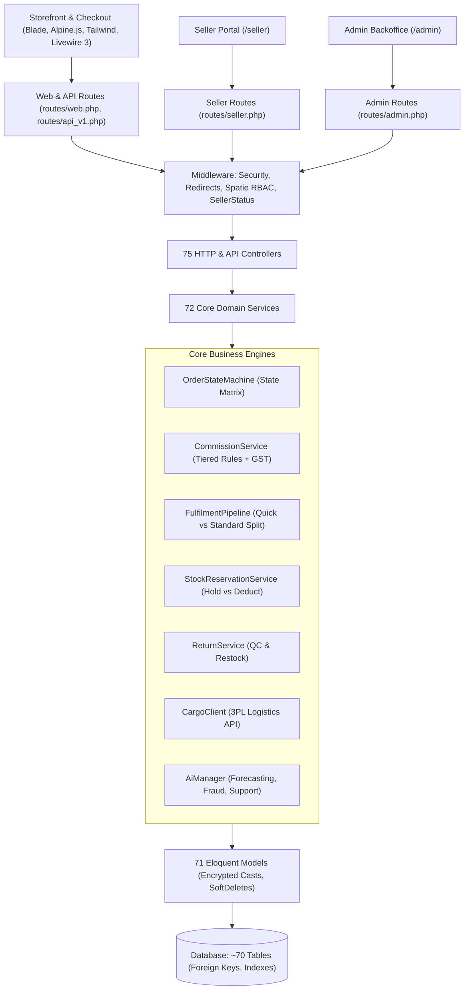
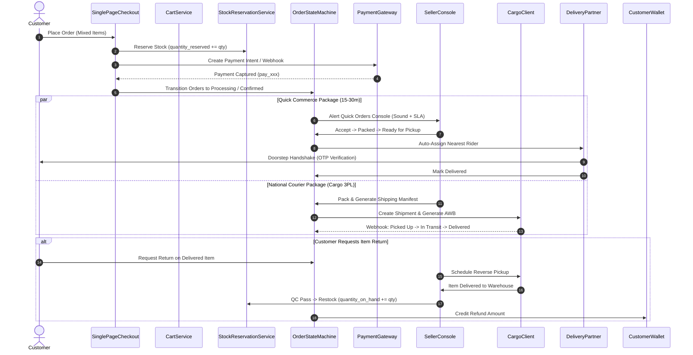

# Comprehensive Project Architecture & Module Audit (PROJECT_AUDIT.md)

**Project:** OneStall - Unified Hyperlocal & Multi-Vendor Marketplace  
**Framework:** Laravel 11.x / PHP 8.2 / Livewire 3 / Alpine.js / Tailwind CSS  
**Database:** MySQL 8.x / SQLite 3  
**Audit Date:** November 15, 2026  
**Status:** Complete Architectural Inspection  

---

## 1. Executive Project Overview & Architectural Topology

### 1.1. Core Application Identity
OneStall is an enterprise-grade, hybrid e-commerce marketplace platform unifying two distinct fulfillment models into a single catalog and checkout experience:
1. **Hyperlocal Quick-Commerce (15–30 Minute Delivery):** Nearby physical store outlets, real-time geofenced serviceability (Haversine formula), store operational hours, acoustic seller dispatch consoles, and dynamic rider assignment.
2. **National Multi-Vendor Courier Delivery (Cargo 3PL):** Multi-seller shipping, automated manifest creation, Air Waybill (AWB) generation, reverse logistics, Non-Delivery Report (NDR) workflows, Return to Origin (RTO), and Cash on Delivery (COD) remittances.

### 1.2. Architecture & Technology Stack

- **Framework:** Laravel 11.x running on PHP 8.2.
- **Routing Surface:** 448 validated routes across 5 route files (`web.php`, `admin.php`, `seller.php`, `api_v1.php`, `console.php`).
- **Data Layer:** 71 Eloquent models, 70 database migrations, strict foreign key constraints, encrypted casts for sensitive financial/tax data (PAN, GSTIN, Bank Accounts).
- **Authentication & RBAC:** Multi-guard authentication with Spatie Laravel-Permission v6, role-specific login flows (`/admin/login`, `/seller/login`, `/login`, and OTP login).
- **Testing Coverage:** 66 automated test suites, 589 tests, 3,233 assertions with 100% pass rate.

---

## 2. User Roles, Permissions & Access Control Matrices

The application implements strict role-based access control (RBAC) across 5 core actor domains:

| Role Identifier | Guard | Target Portal | Key Permissions & Responsibilities |
|---|---|---|---|
| **super_admin** | `web` | `/admin` | Unrestricted backoffice access, purge audit logs, manage staff roles and system settings. |
| **admin** | `web` | `/admin` | Full backoffice management (orders, catalog, moderation, payments, shipping, KYC approval). |
| **catalog_manager** | `web` | `/admin` | Product moderation, categories, brands, attribute groups, and catalog imports. |
| **finance_manager** | `web` | `/admin` | Settlements, commission rules, payout adjustments, manual refund approvals. |
| **support_lead** | `web` | `/admin` | Support desk ticketing, dispute escalation, customer communications, AI reply drafts. |
| **seller_owner** | `web` | `/seller` | Merchant profile owner, multi-store outlets, product catalog, quick orders console, bank accounts, staff invitations. Gated by `EnsureSellerStatus` until KYC approved. |
| **seller_staff** | `web` | `/seller` | Outlet-scoped fulfillment: packing orders, marking ready for pickup, local inventory adjustments. |
| **customer** | `web` | `/` & `/account` | Storefront discovery, cart, checkout, wallet, order tracking, returns filing, reviews, support tickets. |
| **delivery_partner** (Rider) | `api` / `web` | `/rider` | Mobile hyperlocal dispatch: accept assignments, GPS location telemetry, doorstep OTP handover handshake. |
| **guest** | None | Storefront | Public catalog browsing, search, store map, cart simulation, OTP authentication triggers. |

---

## 3. Comprehensive Module Inventory

### 3.1. Admin Backoffice Modules (18 Submodules)
1. **Admin Dashboard (`/admin`):** Real-time GMV, order volume, new seller registrations, active delivery partners, chart data APIs (`/admin/chart-data`), and CSV summary exports.
2. **Catalogue & Product Moderation (`/admin/catalogue`):** Multi-level nested category trees, verified brand badges, attribute sets, and side-by-side product moderation queue with mandatory rejection reasons.
3. **Inventory & Sync Monitoring (`/admin/inventory`, `/admin/inventory/sync-logs`):** Global multi-warehouse stock visibility, low-stock alerts, sync audit logs, and log pruning.
4. **Order Control Console (`/admin/orders`):** Master order inspection, child fulfillment split views, state machine overrides with mandatory audit reasons, internal notes, and tax invoice generation.
5. **Payments & Financial Audits (`/admin/payments`, `/admin/refunds`):** Multi-gateway transaction inspection (Stripe, Razorpay, Cashfree, COD), partial/full refund processing, and immutable audit logs.
6. **Shipping & 3PL Logistics (`/admin/shipping`):** OneStall Cargo integration, API credentials, shipping markup rules, auto-manifest automation, bulk tracking sync, and failed shipment retry queue.
7. **Settlements & Escrow (`/admin/settlements`):** Multi-tier commission rules, payout batch generation, adjustment entries, and PDF/CSV remittance statements.
8. **Returns & Dispute Management (`/admin/returns`):** Item-level return requests, seller dispute adjudication, reverse courier scheduling, and forced customer refunds.
9. **Stores & Geodata Map (`/admin/stores`, `/admin/stores-map`):** Interactive Leaflet/OSM physical store pins, geofenced delivery zones, and store status toggles.
10. **Customer Management (`/admin/customers`):** Customer profile inspection, lifetime order value, wallet balance tracking, and account suspension toggles.
11. **Staff & RBAC Administration (`/admin/staff`):** Staff creation, role assignments, granular Spatie permission matrix updates, and self-deletion safeguards.
12. **Marketing & Promotions (`/admin/coupons`, `/admin/campaigns`, `/admin/banners`):** Coupon codes (percentage/fixed, minimum order, category restrictions), flash deals, and position-based hero banners.
13. **CMS & Content Management (`/admin/cms-pages`):** Dynamic page creation (`/pages/{slug}`), auto-slug generation, and XSS sanitization.
14. **Support Desk (`/admin/support`):** Multi-channel ticket queues, customer message threads, internal staff notes, priority flags, and AI-assisted reply drafting.
15. **Notification System (`/admin/notifications/templates`, `/admin/notifications/logs`):** Dynamic template variables (`{order_number}`, `{customer_name}`, etc.), delivery channel dispatchers, and retry queue.
16. **SEO & Redirects Engine (`/admin/redirects`):** 301/302 redirects, circular redirect loop prevention, dynamic XML sitemaps, and search console meta tags.
17. **Quick Commerce Mission Control (`/admin/quick-commerce`):** Hyperlocal dispatch telemetry, 3-minute SLA monitors, rider allocation feeds, and automated order rerouting.
18. **Audit Trail Logging (`/admin/audit-logs`):** System-wide immutable activity logs with JSON diffs, actor attribution, and retention period enforcement.

### 3.2. Seller Operations Portal (5 Submodules)
1. **Onboarding & KYC Wizard (`/seller/onboarding`):** 7-step guided verification: business details, PAN/GSTIN validation, bank account penny-drop test, store coordinates, and document upload to secure private disk.
2. **Merchant Hub & Outlets (`/seller/dashboard`, `/seller/stores`):** Multi-store outlet management, operational opening hours, store open/closed toggles, and outlet-specific sales reports.
3. **Product Catalog (`/seller/products`):** Simple and variable products, SKU live availability checker, selling price vs MRP validation, and bulk status updates.
4. **Quick Orders Live Dispatch (`/seller/quick-orders`):** Acoustic sound alerts, 3-minute acceptance SLA countdown, packing status, and rider handover verification.
5. **Multi-Store & Connect Shop (`/seller/connections`):** External e-commerce connectors (Shopify, WooCommerce, Custom REST API), webhook ingesters, and inventory sync logs.

### 3.3. Storefront & Customer Modules (2 Submodules)
1. **Storefront & Single-Page Checkout (`/`, `/checkout`):** Mixed cart fulfillment engine (splits items into Quick Commerce and National Courier packages), address geofencing, coupon validation, and wallet payment debit.
2. **Customer Self-Service (`/account`):** Order tracking milestones, item-level return requests, wallet credit/debit transactions, review submissions, and support ticketing.

### 3.4. Logistics & Delivery Partner Telemetry (1 Submodule)
1. **Rider Mobile Interface (`/rider`):** Hyperlocal dispatch assignment, real-time GPS location telemetry, status updates (`driver_assigned` → `out_for_delivery` → `delivered`), and doorstep OTP verification handshake.

### 3.5. Shared Core Engine Subsystems
1. **OrderStateMachine (`app/Services/Order/OrderStateMachine.php`):** Governs all parent order and fulfillment order state transitions, preventing illegal state hops and ensuring idempotency.
2. **CommissionService (`app/Services/Commission/CommissionService.php`):** Resolves tiered commissions, applies statutory 18% GST on platform fees, and accounts for 2% payment gateway deductions.
3. **StockReservationService (`app/Services/Inventory/StockReservationService.php`):** Manages atomic holds (`quantity_reserved`) during checkout and decrements physical stock (`quantity_on_hand`) upon dispatch.
4. **ReturnService (`app/Services/Order/ReturnService.php`):** Coordinates item returns, reverse courier scheduling, QC inspection pass/fail, and automatic inventory restock.
5. **CargoClient (`app/Services/Cargo/CargoClient.php`):** Handles HTTP communication with OneStall Cargo 3PL logistics API for manifests, tracking, and webhooks.

---

## 4. Inter-Module Communication & Data Flow

---

## 5. Database Schema & Data Integrity Analysis

### 5.1. Schema Integrity Highlights
- **Foreign Key Cascades:** `orders` cascade to `fulfilment_orders`, which cascade to `order_items`. Deletion of child items without parent consistency is strictly prevented.
- **Atomic Inventory Segregation:** `inventory` maintains distinct `quantity_on_hand` and `quantity_reserved` columns with a composite unique index on `[product_variant_id, inventory_location_id]`.
- **Soft Deletes:** Applied across all core catalog and business entities (`users`, `sellers`, `stores`, `products`, `categories`, `brands`, `orders`, `fulfilment_orders`).
- **Encrypted Attributes:** Bank account numbers, IFSC codes, PAN, and GSTIN numbers use Laravel's `'encrypted'` model cast to protect sensitive merchant data.
- **Spatial Calculations:** Nearby store and outlet queries use the Haversine trigonometric formula directly in SQL query scopes for low-overhead geofencing.

---

## 6. Previously Modified Code & Regression Verification

During previous audit and fix cycles, 6 critical issues were resolved and verified across shared code paths:
1. **Cargo Client Dynamic Base URL:** [CargoClient.php](file:///c:/xampp/htdocs/multivendorecommercenew/app/Services/Cargo/CargoClient.php) now provides explicit URL getter/setter methods, eliminating test suite cross-contamination.
2. **User Model Wallet Balance Fillable:** [User.php](file:///c:/xampp/htdocs/multivendorecommercenew/app/Models/User.php) includes `'wallet_balance'` in `$fillable`, preventing silent drops during refund updates.
3. **Order State Machine Enum Unwrapping:** [OrderStateMachine.php](file:///c:/xampp/htdocs/multivendorecommercenew/app/Services/Order/OrderStateMachine.php) unwraps `BackedEnum` instances safely before performing string comparisons.
4. **Order Status History Table Pluralization:** Database queries standardized to singular `order_status_history`.
5. **Return Restock Column Alignment:** [ReturnService.php](file:///c:/xampp/htdocs/multivendorecommercenew/app/Services/Order/ReturnService.php) queries standardized to `quantity_on_hand`.
6. **Checkout Delivery Fallback Badges:** [checkout.blade.php](file:///c:/xampp/htdocs/multivendorecommercenew/resources/views/storefront/checkout.blade.php) clearly surfaces package-level delivery modes.

---

## 7. Technical Risk & Integration Assessment

| Integration / Component | Current Implementation | Production Requirement | Risk Level |
|---|---|---|---|
| **Online Payment Gateways** | Razorpay & Cashfree drivers with simulated webhook signatures | Live production merchant keys, webhooks registered in gateway portals | Low |
| **Cargo 3PL Carrier** | `OneStallCargoProvider` using mockable HTTP client | Live OneStall Cargo client ID, secret, and webhook endpoints | Low |
| **SMS / WhatsApp Messaging** | Mock drivers falling back to `log` and `database` channels | Twilio / Gupshup account credentials configured in `.env` | Low |
| **Physical POS Hardware** | PDF/HTML printable invoice generation | Thermal printer ESC/POS driver integration if physical hardware used | Low |

---

## 8. Recommended Audit Order for Subsequent Passes

When performing focused maintenance or future feature enhancements, modules should be audited in the following dependency order:

1. **Shared Foundation & Database:** `OrderStateMachine`, `StockReservationService`, `User` / `Seller` models, and migrations.
2. **Security & Authentication:** Spatie permissions, `EnsureSellerStatus`, auth controllers, and session guards.
3. **Catalog & Inventory:** Products, categories, variants, inventory locations, and stock movements.
4. **Storefront & Checkout:** Single-page checkout, cart calculations, address validation, and order placement action.
5. **Payment Processing:** Gateway drivers, captured webhooks, and payment record creation.
6. **Fulfillment & Logistics:** Quick orders console, Cargo carrier manifests, tracking milestones, and rider telemetry.
7. **Settlements & Financials:** Commission calculations, settlement batch creation, and adjustments.
8. **Post-Purchase Operations:** Return requests, QC restock, refunds, and support ticketing.
9. **Admin Oversight & SEO:** Global metrics, staff management, audit trails, sitemaps, and redirects.
