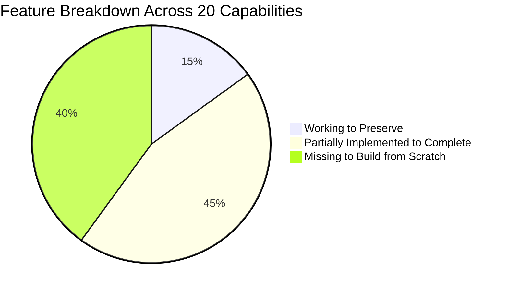
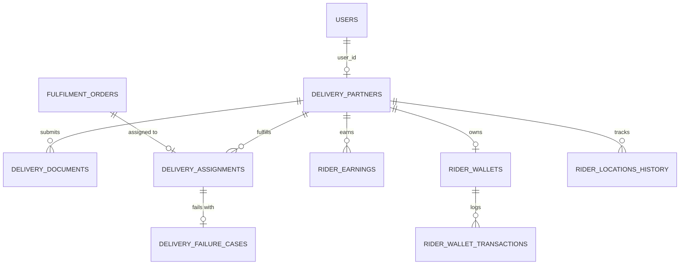
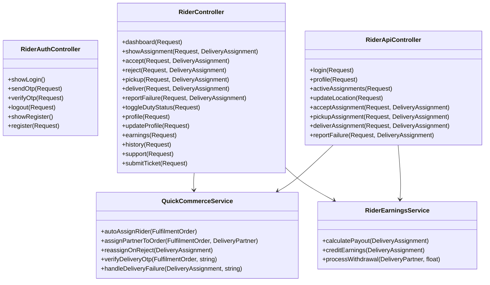
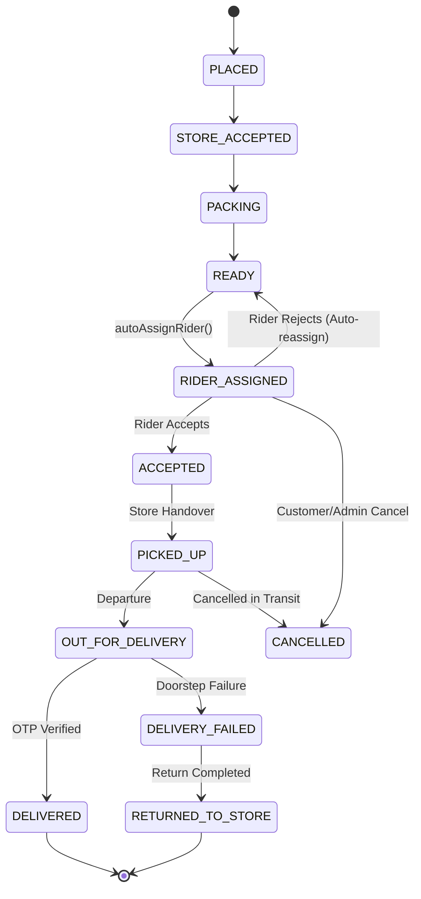
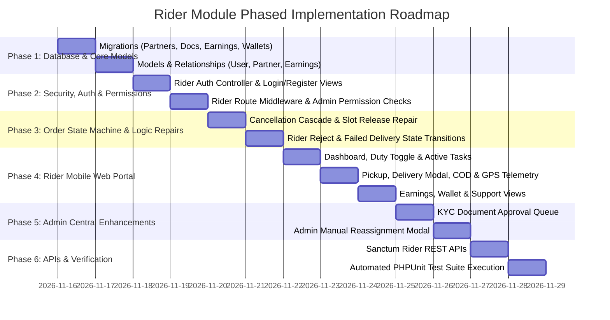

# RIDER / DELIVERY PARTNER MODULE — MASTER DEVELOPMENT PLAN

**Project:** Laravel Multivendor E-Commerce (`OneStall`)  
**Target Module:** Hyperlocal Quick Commerce Delivery Fleet & Rider Operations  
**Date:** 2026-11-15  
**Prerequisites:** Based on findings from:
- `RIDER_STEP_1_DISCOVERY.md` (Architecture & Directory Inventory)
- `RIDER_STEP_2_FUNCTIONALITY_AUDIT.md` (20-Feature Capability Matrix)
- `RIDER_STEP_3_WORKFLOW_ANALYSIS.md` (Order, Shipping & State Machine Lifecycle)
- `RIDER_STEP_4_ADMIN_AUDIT.md` (Admin Central Fleet & Ops Inspection)

---

## 1. Feature Classification & Work Categorization

Based on the multi-step audit, the work is strictly partitioned into four categories:



### 1.1 Existing Working Features — Preserve Without Unnecessary Changes
These components are battle-tested and covered by passing test suites (`tests/Feature/AdminDeliveryPartnersTest.php` and `tests/Feature/SellerQuickOrdersTest.php`). They must **not** be broken or refactored unnecessarily:
1. **Admin Fleet Management CRUD:** [`DeliveryPartnerController@index`](file:///c:/xampp/htdocs/multivendorecommercenew/app/Http/Controllers/Admin/DeliveryPartnerController.php#L52), `@update`, `@toggleStatus`, `@destroy`, and CSV export.
2. **Nearest Rider Auto-Dispatch Engine:** [`QuickCommerceService::autoAssignRider`](file:///c:/xampp/htdocs/multivendorecommercenew/app/Services/QuickCommerce/QuickCommerceService.php#L158) using the spherical Haversine distance formula (`DeliveryPartner::distanceTo`).
3. **Delivery OTP Handshake:** 6-digit cryptographic OTP generation on [`FulfilmentOrder::ensureDeliveryOtp`](file:///c:/xampp/htdocs/multivendorecommercenew/app/Models/FulfilmentOrder.php#L136) and verification via [`QuickCommerceService::verifyDeliveryOtp`](file:///c:/xampp/htdocs/multivendorecommercenew/app/Services/QuickCommerce/QuickCommerceService.php#L246).
4. **Customer Live Map Tracking:** Customer live order tracking screen at [`resources/views/storefront/orders/live-tracking.blade.php`](file:///c:/xampp/htdocs/multivendorecommercenew/resources/views/storefront/orders/live-tracking.blade.php) and telemetry API at [`QuickCommerceController@liveLocationApi`](file:///c:/xampp/htdocs/multivendorecommercenew/app/Http/Controllers/Storefront/QuickCommerceController.php#L109).
5. **Real-time Quick Ops Mission Control:** [`QuickCommerceOpsController@index`](file:///c:/xampp/htdocs/multivendorecommercenew/app/Http/Controllers/Admin/QuickCommerceOpsController.php#L26) and wallboard API feed.

### 1.2 Broken / Logic Gaps — Repair & Harden
1. **Order Cancellation Cascade Gap:** When an order is cancelled in [`OrderStateMachine::cancelOrder`](file:///c:/xampp/htdocs/multivendorecommercenew/app/Services/Order/OrderStateMachine.php#L358), existing active `DeliveryAssignment` records are left dangling in `assigned` / `accepted` / `picked_up` and the rider's `active_orders_count` is never released.  
   *Fix:* Automatically cancel child assignments and free rider capacity when parent order or package is cancelled.
2. **Admin Permission Bypass:** `DeliveryPartnerController` lacks method-level `$this->authorize('cargo.manage')` checks, allowing unauthorized `support_admin` users full deletion/modification access.  
   *Fix:* Enforce explicit Spatie permission checks (`cargo.manage`, `cargo.assign_rider`).
3. **Missing Inverse Relation:** `App\Models\User` lacks `deliveryPartner(): HasOne`.  
   *Fix:* Add inverse Eloquent relationship to `User.php`.

### 1.3 Partially Implemented Features — Complete to Production Standard
1. **Rider Registration & User Provisioning:** Complete `DeliveryPartnerController@store` to auto-provision a linked `User` record with role `delivery_staff` and generated password.
2. **Rider Login & Auth Protection:** Replace demo fallback/switcher with a real authentication flow (Password/SMS OTP) and protect all `/rider/*` routes with auth middleware.
3. **Rider Profile & Document Verification:** Add KYC document upload fields (Driving License, RC, Insurance, PAN/Aadhaar) and document review states.
4. **Rider Task Dashboard:** Enhance [`resources/views/rider/index.blade.php`](file:///c:/xampp/htdocs/multivendorecommercenew/resources/views/rider/index.blade.php) with an online/offline duty toggle, completed shift summary, and order history.
5. **Accept / Reject Flow:** Add missing `reject()` method, reject reason choices, and auto-dispatch fallback to the next nearest rider.
6. **Pickup Management:** Add store handover verification (QR scan or 4-digit store-to-rider PIN) to prevent erroneous package pickups.
7. **Delivery Management & COD:** Add cash collection confirmation modal for Cash on Delivery (COD) orders before OTP verification.
8. **Rider Location Telemetry:** Enhance [`RiderController@updateLocation`](file:///c:/xampp/htdocs/multivendorecommercenew/app/Http/Controllers/Rider/RiderController.php#L153) with HTML5 `watchPosition` continuous streaming and breadcrumbs trail.
9. **Admin Fleet Reports:** Expand CSV export to include SLA adherence metrics, average delivery turnaround, and on-time percentages.

### 1.4 Completely Missing Features — Develop from Scratch
1. **Rider Self-Registration & Onboarding Portal:** Public registration page (`/rider/register`) with document uploads.
2. **Admin Rider Approval & KYC Verification System:** Status machine (`pending`, `under_review`, `approved`, `rejected`, `suspended`) with Admin review buttons.
3. **Failed Delivery & Return-to-Store (RTS) Workflow:** Delivery failure reporting (`customer_unreachable`, `premises_closed`, `refused`) and dark store return task.
4. **Rider Earnings Engine & Rate Configuration:** Payout calculation (base fee + per-km distance + surge bonus + customer tips).
5. **Rider Wallet & COD Cash Ledger:** Cash-in-hand tracking, rider payout balances, withdrawal requests, and Admin settlement.
6. **Rider Push/SMS Notification System:** Direct dispatch alerts (`New Delivery Assignment #FO-XXXX`) via SMS/WhatsApp/Push.
7. **Rider Helpdesk & Emergency SOS:** In-app support ticket submission and emergency SOS dispatch hotline button.
8. **Admin Manual Assignment & Dispatch Override:** Admin UI modal on `/admin/orders/{order}` to assign or reassign any rider manually.
9. **Sanctum-Authenticated Mobile REST APIs:** Complete API suite under `/api/v1/rider/*` for future Flutter/React Native mobile apps.

---

## 2. Database Changes (Migrations, Schemas & Indexes)



### 2.1 Enhance Existing Table: `delivery_partners`
Create migration `2026_11_16_010000_enhance_delivery_partners_table.php`:
- `approval_status` (string 32, default `'approved'`, index: `'pending'`, `'under_review'`, `'approved'`, `'rejected'`, `'suspended'`).
- `approved_at` (timestamp, nullable).
- `approved_by` (foreignId to `users.id`, nullable, nullOnDelete).
- `rejection_reason` (text, nullable).
- `cash_in_hand_limit` (decimal 12,2, default 5000.00).
- `current_cash_in_hand` (decimal 12,2, default 0.00).
- `rating_average` (decimal 3,2, default 5.00).
- `rating_count` (unsigned int, default 0).
- `emergency_contact_name` (string 100, nullable).
- `emergency_contact_phone` (string 20, nullable).

### 2.2 Enhance Existing Table: `delivery_assignments`
Create migration `2026_11_16_010001_enhance_delivery_assignments_table.php`:
- `pickup_otp` (string 4, nullable) — store handover verification PIN.
- `pickup_otp_verified` (boolean, default false).
- `rejection_reason` (string 255, nullable).
- `rejected_at` (timestamp, nullable).
- `failed_at` (timestamp, nullable).
- `failure_reason` (string 64, nullable: `'customer_unreachable'`, `'address_not_found'`, `'customer_refused'`, `'store_cancelled'`, `'accident_breakdown'`).
- `failure_notes` (text, nullable).
- `proof_of_delivery_image` (string 255, nullable).
- `cod_amount_collected` (decimal 12,2, default 0.00).
- `cod_collected_at` (timestamp, nullable).
- `rider_earnings_amount` (decimal 12,2, default 0.00).

### 2.3 New Table: `delivery_documents` (Rider KYC)
Create migration `2026_11_16_010002_create_delivery_documents_table.php`:
- `id` (bigint, primary key).
- `delivery_partner_id` (foreignId to `delivery_partners.id`, cascadeOnDelete).
- `document_type` (string 32: `'driving_license_front'`, `'driving_license_back'`, `'vehicle_rc'`, `'insurance'`, `'aadhaar_card'`, `'pan_card'`).
- `document_number` (string 64, nullable).
- `file_path` (string 255).
- `verification_status` (string 32, default `'pending'`: `'pending'`, `'approved'`, `'rejected'`).
- `rejection_reason` (text, nullable).
- `expires_at` (date, nullable).
- `verified_at` (timestamp, nullable).
- `verified_by` (foreignId to `users.id`, nullable, nullOnDelete).
- `timestamps`.
- Index: `['delivery_partner_id', 'document_type']`.

### 2.4 New Table: `rider_earnings`
Create migration `2026_11_16_010003_create_rider_earnings_table.php`:
- `id` (bigint, primary key).
- `delivery_partner_id` (foreignId to `delivery_partners.id`, cascadeOnDelete).
- `delivery_assignment_id` (foreignId to `delivery_assignments.id`, cascadeOnDelete).
- `fulfilment_order_id` (foreignId to `fulfilment_orders.id`, cascadeOnDelete).
- `base_payout` (decimal 12,2, default 0.00).
- `distance_km` (decimal 8,2, default 0.00).
- `distance_payout` (decimal 12,2, default 0.00).
- `surge_bonus` (decimal 12,2, default 0.00).
- `customer_tip` (decimal 12,2, default 0.00).
- `total_payout` (decimal 12,2, default 0.00).
- `status` (string 32, default `'credited'`: `'credited'`, `'held'`, `'settled'`).
- `settled_at` (timestamp, nullable).
- `timestamps`.
- Index: `['delivery_partner_id', 'status', 'created_at']`.

### 2.5 New Table: `rider_wallets` & `rider_wallet_transactions`
Create migration `2026_11_16_010004_create_rider_wallets_table.php`:
- `rider_wallets`:
  - `id` (bigint, primary key).
  - `delivery_partner_id` (foreignId to `delivery_partners.id`, cascadeOnDelete, unique).
  - `balance` (decimal 12,2, default 0.00).
  - `pending_payout` (decimal 12,2, default 0.00).
  - `total_earned` (decimal 12,2, default 0.00).
  - `timestamps`.
- `rider_wallet_transactions`:
  - `id` (bigint, primary key).
  - `rider_wallet_id` (foreignId to `rider_wallets.id`, cascadeOnDelete).
  - `type` (string 20: `'credit'`, `'debit'`).
  - `amount` (decimal 12,2).
  - `balance_after` (decimal 12,2).
  - `category` (string 32: `'delivery_payout'`, `'distance_bonus'`, `'tip'`, `'cod_deduction'`, `'admin_adjustment'`, `'bank_withdrawal'`).
  - `reference_type` (string nullable).
  - `reference_id` (unsignedBigInteger nullable).
  - `description` (string 255).
  - `timestamps`.
  - Index: `['rider_wallet_id', 'created_at']`.

### 2.6 New Table: `rider_locations_history` (Telemetry Breadcrumbs)
Create migration `2026_11_16_010005_create_rider_locations_history_table.php`:
- `id` (bigint, primary key).
- `delivery_partner_id` (foreignId to `delivery_partners.id`, cascadeOnDelete).
- `delivery_assignment_id` (foreignId to `delivery_assignments.id`, nullable, nullOnDelete).
- `lat` (decimal 10,7).
- `lng` (decimal 10,7).
- `speed` (decimal 6,2, nullable).
- `heading` (decimal 5,2, nullable).
- `recorded_at` (timestamp).
- Index: `['delivery_partner_id', 'recorded_at']`.
- Index: `['delivery_assignment_id', 'recorded_at']`.

---

## 3. Models and Relationships Architecture

### 3.1 Existing Models Enhancement

#### `App\Models\DeliveryPartner`
```php
// New Relationships
public function documents(): HasMany { return $this->hasMany(DeliveryDocument::class); }
public function earnings(): HasMany { return $this->hasMany(RiderEarning::class); }
public function wallet(): HasOne { return $this->hasOne(RiderWallet::class); }
public function locationsHistory(): HasMany { return $this->hasMany(RiderLocationHistory::class); }
public function approvedBy(): BelongsTo { return $this->belongsTo(User::class, 'approved_by'); }

// New Scopes
public function scopeApproved(Builder $q): Builder { return $q->where('approval_status', 'approved'); }
public function scopePendingApproval(Builder $q): Builder { return $q->where('approval_status', 'pending'); }

// Helper Methods
public function isApproved(): bool { return $this->approval_status === 'approved'; }
public function ensureWallet(): RiderWallet { return $this->wallet()->firstOrCreate([], ['balance' => 0.00]); }
```

#### `App\Models\DeliveryAssignment`
```php
public function earnings(): HasOne { return $this->hasOne(RiderEarning::class); }
public function locations(): HasMany { return $this->hasMany(RiderLocationHistory::class); }
```

#### `App\Models\User`
```php
public function deliveryPartner(): HasOne { return $this->hasOne(DeliveryPartner::class); }
```

### 3.2 New Models to Create
1. `App\Models\DeliveryDocument` (`belongsTo DeliveryPartner`, `belongsTo verifiedBy User`).
2. `App\Models\RiderEarning` (`belongsTo DeliveryPartner`, `belongsTo DeliveryAssignment`, `belongsTo FulfilmentOrder`).
3. `App\Models\RiderWallet` (`belongsTo DeliveryPartner`, `hasMany RiderWalletTransaction`).
4. `App\Models\RiderWalletTransaction` (`belongsTo RiderWallet`).
5. `App\Models\RiderLocationHistory` (`belongsTo DeliveryPartner`, `belongsTo DeliveryAssignment`).

---

## 4. Controllers and Services Architecture



### 4.1 New Controllers & Action Handlers
1. `App\Http\Controllers\Rider\RiderAuthController`:
   - Dedicated authentication controller for riders (`showLogin`, `login`, `sendOtp`, `verifyOtp`, `logout`, `showRegister`, `register`).
2. `App\Http\Controllers\Rider\RiderController` (Enhancement):
   - Add `reject()`, `reportFailure()`, `toggleDutyStatus()`, `profile()`, `updateProfile()`, `earnings()`, `history()`, `support()`, `submitTicket()`.
3. `App\Http\Controllers\Api\V1\RiderApiController`:
   - Sanctum token-protected RESTful API for mobile app integration.
4. `App\Http\Controllers\Admin\RiderApprovalController`:
   - Admin review of pending driver applications and KYC documents (`index`, `show`, `approve`, `reject`).
5. `App\Http\Controllers\Admin\RiderSettlementController`:
   - Admin view of rider wallets, cash-in-hand reconciliation, and payout batch processing.

### 4.2 New Service Classes
1. `App\Services\Rider\RiderEarningsService`:
   - Calculates base pay, distance surcharge, surge bonus, tips, and records credit transactions into `rider_wallets`.
2. `App\Services\Rider\RiderNotificationService`:
   - Dispatches transactional SMS, WhatsApp, and Firebase Cloud Messaging (FCM) push notifications on assignment, cancellation, and payout events.

---

## 5. Routes and API Specifications

```
ROUTES ARCHITECTURE:
├── routes/web.php
│   ├── Guest Rider Routes (throttle:10,1)
│   │   ├── GET  /rider/login
│   │   ├── POST /rider/login
│   │   ├── GET  /rider/register
│   │   └── POST /rider/register
│   └── Protected Rider Portal (middleware: ['auth', 'role:delivery_staff'])
│       ├── GET  /rider
│       ├── POST /rider/duty-toggle
│       ├── GET  /rider/orders/{assignment}
│       ├── POST /rider/orders/{assignment}/accept
│       ├── POST /rider/orders/{assignment}/reject
│       ├── POST /rider/orders/{assignment}/pickup
│       ├── POST /rider/orders/{assignment}/deliver
│       ├── POST /rider/orders/{assignment}/fail
│       ├── POST /rider/location
│       ├── GET  /rider/profile
│       ├── POST /rider/profile
│       ├── GET  /rider/earnings
│       ├── GET  /rider/history
│       ├── GET  /rider/support
│       └── POST /rider/support/ticket
├── routes/admin.php (middleware: ['auth', 'role:super_admin|admin'])
│   ├── Prefix: /admin/delivery-partners
│   │   ├── GET  /approvals                     (Pending KYC queue)
│   │   ├── GET  /approvals/{partner}           (Document review)
│   │   ├── POST /approvals/{partner}/approve   (Approve rider)
│   │   ├── POST /approvals/{partner}/reject    (Reject with reason)
│   │   ├── GET  /settlements                   (Wallets & payouts)
│   │   ├── POST /settlements/{partner}/payout  (Process transfer)
│   │   └── POST /orders/{fo}/assign-rider      (Admin manual override)
└── routes/api_v1.php
    └── Prefix: /api/v1/rider
        ├── POST /login                         (Issue Sanctum token)
        └── Protected (middleware: 'auth:sanctum')
            ├── GET  /profile
            ├── POST /status
            ├── POST /location                  (Authenticated telemetry)
            ├── GET  /assignments/active
            ├── GET  /assignments/history
            ├── POST /assignments/{id}/accept
            ├── POST /assignments/{id}/reject
            ├── POST /assignments/{id}/pickup
            ├── POST /assignments/{id}/deliver
            └── POST /assignments/{id}/fail
```

---

## 6. Admin Panel Changes

### 6.1 Fleet Listing & KYC Integration ([`resources/views/admin/delivery-partners/index.blade.php`](file:///c:/xampp/htdocs/multivendorecommercenew/resources/views/admin/delivery-partners/index.blade.php))
- Add a top sub-navigation / tabs:
  - **All Fleet Riders** (Current table)
  - **Pending KYC Applications** (Badge showing pending count)
  - **Rider Wallets & COD Reconciliation**
  - **Performance & SLA Leaderboard**
- Add an `Approval Status` column (`Approved`, `Under Review`, `Pending`, `Suspended`).

### 6.2 Admin Manual Assignment Modal on Orders ([`resources/views/admin/orders/show.blade.php`](file:///c:/xampp/htdocs/multivendorecommercenew/resources/views/admin/orders/show.blade.php))
- Replace the read-only logistics ribbon with an interactive action bar:
  - If unassigned: `+ Assign Delivery Rider` button.
  - If assigned: `Reassign Rider` button.
  - Opens a modal listing available online riders within the dark store's radius, displaying their real-time distance in kilometers, current active load, and vehicle type.

### 6.3 Admin Failed Delivery Queue
- Add a tab or filter on `/admin/quick-commerce`:
  - Lists quick-commerce orders flagged `delivery_failed`.
  - Shows rider remarks (e.g., "Customer phone switched off at doorstep").
  - Actions: **Retry Doorstep Delivery** or **Confirm Return to Store & Restock**.

---

## 7. Rider Interface Enhancements (Mobile Web Portal)

### 7.1 Modernized Mobile Experience ([`resources/views/rider/index.blade.php`](file:///c:/xampp/htdocs/multivendorecommercenew/resources/views/rider/index.blade.php))
- **Duty Toggle:** Prominent toggle button `🟢 Online (Receiving Orders)` / `⚪ Offline (Duty Paused)` that updates status via AJAX.
- **Continuous Geolocation:** Implement `navigator.geolocation.watchPosition` in Alpine.js with automatic background pinging every 15 seconds while online.
- **Bottom Navigation Bar:**
  - 🛵 **Tasks** (Active Deliveries)
  - 📊 **Earnings** (Today's pay, weekly balance, tips)
  - 📜 **History** (Delivered order archive)
  - 👤 **Profile** (Vehicle details, KYC documents, Duty hours)

### 7.2 Assignment Detail Screen ([`resources/views/rider/assignment.blade.php`](file:///c:/xampp/htdocs/multivendorecommercenew/resources/views/rider/assignment.blade.php))
- **Accept / Reject Prompt:** When `status === 'assigned'`, show dual buttons:
  - `✓ Accept Assignment` (Blue)
  - `✕ Decline Job` (Slate/Rose, prompts for reason)
- **Store Pickup Verification:** Store counter displays a 4-digit PIN or package barcode to confirm pickup.
- **Doorstep Delivery & COD:**
  - If COD order, display cash collection box: `⚠️ Collect ₹1,499 in Cash`.
  - Checkbox: `[x] Cash Received & Counted`.
  - OTP verification modal.
- **Delivery Exception Reporting:** Button `"Unable to Deliver?"` opening a modal with standard reasons and optional remarks.

---

## 8. Order, Shipping & State Machine Integrations

### 8.1 State Transitions Flowchart


### 8.2 Order Cancellation Repair in `OrderStateMachine`
Update `cancelOrder()` to cleanly handle active rider assignments:
```php
if ($fo->deliveryAssignment && in_array($fo->deliveryAssignment->status, ['assigned', 'accepted', 'picked_up'])) {
    $assignment = $fo->deliveryAssignment;
    $assignment->status = DeliveryAssignmentStatus::CANCELLED;
    $assignment->notes = "Order cancelled: {$reason}";
    $assignment->save();
    
    if ($assignment->deliveryPartner) {
        $partner = $assignment->deliveryPartner;
        $partner->active_orders_count = max(0, $partner->active_orders_count - 1);
        if ($partner->active_orders_count === 0) {
            $partner->status = 'available';
        }
        $partner->save();
        
        // Notify rider
        app(RiderNotificationService::class)->sendOrderCancelledAlert($partner, $fo);
    }
}
```

---

## 9. Security, Auth & Permissions Architecture

### 9.1 Authentication & Guards
- Guard: Web guard with role `delivery_staff` and Sanctum API token guard (`auth:sanctum`).
- User creation: Automatically provision a `users` table record whenever a rider registers or is created by Admin.
- Middleware: Protect `/rider/*` with `middleware(['auth', 'role:delivery_staff'])`.
- API Security: Protect `/api/v1/rider/*` with `auth:sanctum`.

### 9.2 Admin Permission Enforcement
Update `DeliveryPartnerController` to check Spatie permissions:
```php
public function __construct()
{
    $this->middleware('permission:cargo.view')->only(['index', 'export']);
    $this->middleware('permission:cargo.manage')->only(['store', 'update', 'destroy', 'toggleStatus']);
}
```

---

## 10. Impact Analysis on Shared Files

The following files are shared across Admin, Seller, and Customer modules. They must be modified with zero disruption to existing marketplace logic:

| Shared File | What Touches It | Impact & Mitigation |
| :--- | :--- | :--- |
| `app/Models/User.php` | Add `deliveryPartner(): HasOne` | Non-breaking; purely additive Eloquent relationship. |
| `app/Services/Order/OrderStateMachine.php` | Add cancellation cleanup & failure transitions | Additive condition inside `cancelOrder`; preserve all existing parent reconciliation logic. |
| `routes/web.php` | Add rider auth routes & middleware | Rider group currently has no middleware; wrapping with `auth` will secure it without affecting storefront or checkout. |
| `routes/api_v1.php` | Add authenticated `/api/v1/rider/*` endpoints | Additive API prefix; no conflict with existing `/api/v1/quick/stores` or `/api/v1/integrations/*`. |
| `resources/views/admin/orders/show.blade.php` | Add Manual Reassign modal button | Visual enhancement on quick-commerce ribbon; does not change order detail display or standard courier display. |
| `config/menu.php` | Add KYC approvals badge to menu | Additive badge in Admin navigation; does not alter existing links. |

---

## 11. Testing Requirements

A comprehensive suite of automated tests will verify the entire implementation:

### 11.1 Rider Portal Tests (`tests/Feature/RiderPortalTest.php`)
- `test_unauthenticated_user_cannot_access_rider_portal`
- `test_rider_can_login_with_phone_and_password_or_otp`
- `test_rider_can_view_active_assignments`
- `test_rider_can_accept_assigned_order`
- `test_rider_can_reject_assigned_order_and_triggers_redispatch`
- `test_rider_can_confirm_store_pickup`
- `test_rider_can_complete_delivery_with_valid_otp`
- `test_rider_cannot_complete_delivery_with_invalid_otp`
- `test_rider_can_report_failed_delivery_with_reason`
- `test_rider_can_toggle_online_offline_duty_status`
- `test_rider_can_update_live_gps_telemetry`
- `test_rider_earnings_credited_upon_successful_delivery`

### 11.2 Admin Fleet Tests (`tests/Feature/AdminFleetManagementTest.php`)
- `test_admin_can_view_pending_kyc_rider_applications`
- `test_admin_can_approve_or_reject_rider_kyc`
- `test_admin_can_manually_assign_and_reassign_rider_to_order`
- `test_support_admin_without_permission_cannot_delete_rider`
- `test_admin_can_view_failed_delivery_queue`

### 11.3 State Machine & Order Integration Tests
- `test_cancelling_order_releases_assigned_rider_and_decrements_count`
- `test_rejecting_order_frees_first_rider_and_assigns_second_nearest_rider`

---

## 12. Phased Implementation Roadmap



---
*Plan created in compliance with project architecture and audit findings. Ready for implementation review.*
