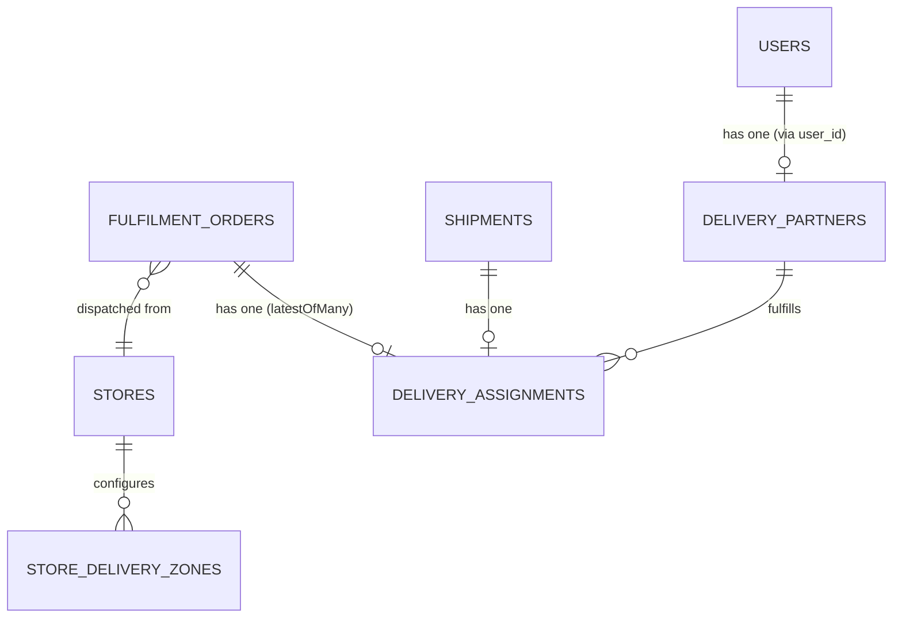

# RIDER / DELIVERY PARTNER DISCOVERY REPORT (STEP 1)

**Project:** Laravel Multivendor E-Commerce (`OneStall`)  
**Discovery Date:** 2026-11-15  
**Scope:** Comprehensive inspection of existing Rider / Delivery Partner architecture, database, models, controllers, routes, middleware, views, and integrations.

---

## 1. Executive Summary

The Rider / Delivery Partner module is **not missing**. A functional foundation is already implemented for **Quick Commerce (10–30 min hyperlocal delivery)** alongside a fleet management module in the Admin console and store-level dispatch tools for Sellers.

The architecture separates delivery into two models:
1. **Hyperlocal Quick Commerce (Rider Fleet):** Uses dedicated `DeliveryPartner` and `DeliveryAssignment` records, Haversine GPS proximity ranking, automated dispatch on store pack completion, customer 6-digit OTP handshake verification, and mobile telemetry.
2. **National Freight Logistics (OneStall Cargo):** Uses third-party couriers (Delhivery, BlueDart, Shadowfax, OneStall Cargo) via AWBs, shipping labels, NDR/RTO handling, and tracking webhooks (`Shipment` model).

The Rider frontend currently exists as a **mobile-responsive web portal** (`/rider`) built with Tailwind CSS and Alpine.js, rather than a standalone native mobile app (Flutter/React Native).

---

## 2. Directory & File Inventory

### Controllers & Services
| Component | Actual File Path | Purpose |
| :--- | :--- | :--- |
| **Rider Portal Controller** | `app/Http/Controllers/Rider/RiderController.php` | Rider web dashboard, task detail, job acceptance, store pickup, OTP delivery, GPS ping, demo switcher |
| **Admin Fleet Controller** | `app/Http/Controllers/Admin/DeliveryPartnerController.php` | Admin fleet CRUD, status toggling, CSV export, telemetry display |
| **Seller Quick Dispatch** | `app/Http/Controllers/Seller/QuickOrderController.php` | Seller quick order acceptance, manual rider assign, auto-dispatch trigger, handover |
| **Seller Staff Assign** | `app/Http/Controllers/Seller/OrderController.php` | Assigning store staff or delivery partner to package |
| **Storefront Live Tracking** | `app/Http/Controllers/Storefront/QuickCommerceController.php` | Realtime telemetry API and customer map tracking |
| **Quick Commerce Service** | `app/Services/QuickCommerce/QuickCommerceService.php` | Rider auto-dispatch engine, Haversine nearest ranking, OTP verification handshake, ops metrics |
| **Order State Machine** | `app/Services/Order/OrderStateMachine.php` | Lifecycle transitions (`ready -> rider_assigned -> picked_up -> out_for_delivery -> delivered`), auto-dispatch trigger |

### Models & Enums
| Component | Actual File Path | Purpose |
| :--- | :--- | :--- |
| **DeliveryPartner Model** | `app/Models/DeliveryPartner.php` | Rider profile, vehicle info, status, active orders count, current GPS coordinates, Haversine helper |
| **DeliveryAssignment Model** | `app/Models/DeliveryAssignment.php` | Pivot assignment between `FulfilmentOrder`/`Shipment` and `DeliveryPartner`, lifecycle timestamps, OTP verification flag |
| **StoreDeliveryZone Model** | `app/Models/StoreDeliveryZone.php` | Store delivery boundaries (radius in km, pincodes, fees, quick flag) |
| **FulfilmentOrder Model** | `app/Models/FulfilmentOrder.php` | Has `delivery_otp`, `delivery_fee`, and relationships to `DeliveryAssignment` |
| **Shipment Model** | `app/Models/Shipment.php` | Has optional relation `deliveryAssignment()` |
| **User Model** | `app/Models/User.php` | User accounts with Spatie roles (`delivery_staff`, `cargo_agent`) |
| **Assignment Status Enum** | `app/Enums/DeliveryAssignmentStatus.php` | Statuses: `assigned`, `accepted`, `rejected`, `picked_up`, `delivered`, `cancelled` |
| **Quick Status Enum** | `app/Enums/QuickFulfilmentStatus.php` | Statuses: `placed`, `store_accepted`, `packing`, `ready`, `rider_assigned`, `picked_up`, `out_for_delivery`, `delivered`, `cancelled` |
| **DeliveryZoneType Enum** | `app/Enums/DeliveryZoneType.php` | Types: `radius`, `pincode_list` |

### Database Migrations & Factories
| File Path | Description |
| :--- | :--- |
| `database/migrations/2026_11_05_010009_create_store_delivery_zones_table.php` | Defines store delivery zones, radius km, pincodes, delivery fees |
| `database/migrations/2026_11_05_030022_create_delivery_partners_table.php` | Initial `delivery_partners` table (name, phone, vehicle, coordinates) |
| `database/migrations/2026_11_05_030023_create_delivery_assignments_table.php` | Initial `delivery_assignments` table with timestamps and foreign keys |
| `database/migrations/2026_11_05_190000_enhance_quick_commerce_tables.php` | Adds `status`, `active_orders_count`, `last_location_updated_at` to partners; `delivery_otp` to fulfilment orders; `otp_verified`, `notes` to assignments |
| `database/factories/DeliveryPartnerFactory.php` | Factory for generating test riders |
| `database/factories/DeliveryAssignmentFactory.php` | Factory for generating test delivery assignments |
| `database/factories/StoreDeliveryZoneFactory.php` | Factory for generating delivery zones |

### Blade Views
| File Path | Description |
| :--- | :--- |
| `resources/views/rider/index.blade.php` | Mobile-friendly Rider Dashboard (active task cards, GPS simulation ping button, profile header, rider switch dropdown) |
| `resources/views/rider/assignment.blade.php` | Mobile Assignment Detail (store pickup card, customer drop card, package item list, action buttons for Accept / Pickup / Deliver with OTP modal) |
| `resources/views/admin/delivery-partners/index.blade.php` | Admin Fleet Management Console (metrics cards, filter toolbar, rider table with Google Maps coordinate links, modal to register/edit rider, delete/toggle actions) |
| `resources/views/admin/quick-commerce/index.blade.php` | Admin Quick Ops Mission Control (shows available vs. total riders count and busy count) |
| `resources/views/storefront/orders/live-tracking.blade.php` | Customer Live Order Tracking (visual progress bar, live map coordinates, rider card with phone link) |

### Tests
| File Path | Description | Current Status |
| :--- | :--- | :--- |
| `tests/Feature/AdminDeliveryPartnersTest.php` | 8 tests covering fleet list, filters, store, update, toggle duty status, idle delete, active assignment delete restriction, CSV export | **PASS** (8 passed, 31 assertions) |
| `tests/Feature/SellerQuickOrdersTest.php` | Tests seller assigning rider and order handover | **PASS** |

---

## 3. Database Schema Details

### 1. Table: `delivery_partners`
- `id` (bigint, primary key)
- `user_id` (bigint, nullable, foreign key -> `users.id` on delete set null)
- `name` (varchar 255)
- `phone` (varchar 20, unique, indexed)
- `vehicle` (varchar 50: 'Electric Scooter', 'Motorcycle', 'Bicycle', 'Van')
- `vehicle_number` (varchar 30, nullable)
- `is_active` (boolean, default true, indexed)
- `status` (varchar 32, default 'available', indexed: 'available', 'busy', 'offline')
- `active_orders_count` (unsigned int, default 0)
- `current_lat` (decimal 10,7, nullable)
- `current_lng` (decimal 10,7, nullable)
- `last_location_updated_at` (timestamp, nullable)
- `created_at`, `updated_at` (timestamps)
- **Indexes:** `['is_active', 'current_lat', 'current_lng']`, `phone`, `status`

### 2. Table: `delivery_assignments`
- `id` (bigint, primary key)
- `fulfilment_order_id` (bigint, foreign key -> `fulfilment_orders.id` on delete cascade)
- `shipment_id` (bigint, nullable, foreign key -> `shipments.id` on delete set null)
- `delivery_partner_id` (bigint, foreign key -> `delivery_partners.id` on delete cascade)
- `status` (varchar 32, default 'assigned', indexed: 'assigned', 'accepted', 'rejected', 'picked_up', 'delivered', 'cancelled')
- `otp_verified` (boolean, default false)
- `notes` (text, nullable)
- `assigned_at` (timestamp)
- `accepted_at` (timestamp, nullable)
- `picked_up_at` (timestamp, nullable)
- `delivered_at` (timestamp, nullable)
- `created_at`, `updated_at` (timestamps)
- **Indexes:** `['delivery_partner_id', 'status']`, `status`

### 3. Table: `store_delivery_zones`
- `id` (bigint, primary key)
- `store_id` (bigint, foreign key -> `stores.id` on delete cascade)
- `type` (varchar 32, default 'radius': 'radius', 'pincode_list')
- `radius_km` (decimal 8,2, nullable)
- `pincodes` (json, nullable)
- `min_order_value` (decimal 12,2, default 0.00)
- `delivery_fee` (decimal 12,2, default 0.00)
- `is_quick` (boolean, default false, indexed)
- `created_at`, `updated_at` (timestamps)

### 4. Related Columns in `fulfilment_orders`
- `delivery_otp` (varchar 6, nullable)
- `delivery_fee` (decimal 12,2, default 0.00)
- `estimated_delivery_at` (timestamp, nullable)
- `delivered_at` (timestamp, nullable)
- `status` includes: `ready`, `rider_assigned`, `picked_up`, `out_for_delivery`, `delivered`

### 5. Related Columns in `stores`
- `quick_auto_assign_rider` (boolean, default true)

---

## 4. Models and Relationships

1. **`DeliveryPartner` (`App\Models\DeliveryPartner`)**:
   - `user()` -> `BelongsTo(User::class)`
   - `assignments()` -> `HasMany(DeliveryAssignment::class)`
   - `activeAssignment()` -> `HasOne(DeliveryAssignment::class)->whereIn('status', ['assigned', 'accepted', 'picked_up'])->latestOfMany()`
   - `distanceTo(float $targetLat, float $targetLng): float` -> Calculates Haversine distance in km.
   - Scopes: `scopeActive`, `scopeAvailable`.

2. **`DeliveryAssignment` (`App\Models\DeliveryAssignment`)**:
   - `fulfilmentOrder()` -> `BelongsTo(FulfilmentOrder::class)`
   - `shipment()` -> `BelongsTo(Shipment::class)`
   - `deliveryPartner()` -> `BelongsTo(DeliveryPartner::class)`

3. **`FulfilmentOrder` (`App\Models\FulfilmentOrder`)**:
   - `deliveryAssignments()` -> `HasMany(DeliveryAssignment::class)`
   - `deliveryAssignment()` -> `HasOne(DeliveryAssignment::class)->latestOfMany()`
   - `ensureDeliveryOtp(): string` -> Generates or returns 6-digit random code (`mt_rand(100000, 999999)`).

4. **`Shipment` (`App\Models\Shipment`)**:
   - `deliveryAssignment()` -> `HasOne(DeliveryAssignment::class)`

5. **`User` (`App\Models\User`)**:
   - Uses `Spatie\Permission\Traits\HasRoles`.
   - Role `delivery_staff` and `cargo_agent` exist in seeders.
   - **Note:** Missing inverse `public function deliveryPartner(): HasOne` on `User.php`.

---

## 5. Routes and Endpoints

### 1. Rider Web Portal (`routes/web.php`)
| Method | URI | Route Name | Action | Description |
| :--- | :--- | :--- | :--- | :--- |
| `GET` | `/rider` | `rider.dashboard` | `RiderController@dashboard` | Rider mobile web dashboard |
| `GET` | `/rider/orders/{assignment}` | `rider.assignment` | `RiderController@showAssignment` | View order drop-off details & items |
| `POST` | `/rider/orders/{assignment}/accept` | `rider.accept` | `RiderController@accept` | Accept assigned task |
| `POST` | `/rider/orders/{assignment}/pickup` | `rider.pickup` | `RiderController@pickup` | Confirm pickup from store; sets FO out for delivery |
| `POST` | `/rider/orders/{assignment}/deliver` | `rider.deliver` | `RiderController@deliver` | Verify OTP and mark delivered |
| `POST` | `/rider/location` | `rider.location_api` | `RiderController@updateLocation` | Web GPS ping endpoint |
| `POST` | `/rider/switch` | `rider.switch` | `RiderController@switchRider` | Switch active demo rider profile |

### 2. Admin Delivery Fleet (`routes/admin.php`)
*Prefix: `/admin`, Middleware: `['auth', 'role:super_admin|admin|support_admin']`*
| Method | URI | Route Name | Action | Description |
| :--- | :--- | :--- | :--- | :--- |
| `GET` | `/admin/delivery-partners` | `admin.delivery_partners.index` | `DeliveryPartnerController@index` | Fleet listing, metrics, filters |
| `POST` | `/admin/delivery-partners` | `admin.delivery_partners.store` | `DeliveryPartnerController@store` | Register new rider |
| `PUT` | `/admin/delivery-partners/{partner}` | `admin.delivery_partners.update` | `DeliveryPartnerController@update` | Update rider profile/status |
| `DELETE` | `/admin/delivery-partners/{partner}` | `admin.delivery_partners.destroy` | `DeliveryPartnerController@destroy` | Delete idle rider |
| `POST` | `/admin/delivery-partners/{partner}/toggle`| `admin.delivery_partners.toggle` | `DeliveryPartnerController@toggleStatus`| Toggle online/offline status |
| `GET` | `/admin/delivery-partners/export` | `admin.delivery_partners.export` | `DeliveryPartnerController@export` | Export fleet to CSV |

### 3. Seller Order Dispatch (`routes/seller.php`)
*Prefix: `/seller`, Middleware: `['auth', 'role:seller_owner|store_manager']`*
| Method | URI | Route Name | Action | Description |
| :--- | :--- | :--- | :--- | :--- |
| `POST` | `/seller/orders/{fulfilmentOrder}/assign-rider` | `seller.orders.assign_rider` | `QuickOrderController@assignRider` | Assign rider manually or trigger nearest auto-dispatch |
| `POST` | `/seller/orders/{fulfilmentOrder}/assign-staff` | `seller.orders.assign_staff` | `OrderController@assignStaff` | Standard assign staff/partner |
| `POST` | `/seller/quick/orders/{fo}/handover` | `seller.quick.orders.handover` | `QuickOrderController@handover` | Handover order to rider |

### 4. API Endpoints (`routes/api_v1.php`)
| Method | URI | Route Name | Action | Auth / Protection |
| :--- | :--- | :--- | :--- | :--- |
| `POST` | `/api/v1/rider/location` | `api.rider.location` | `RiderController@updateLocation` | **None** (Public telemetry endpoint) |
| `GET` | `/api/v1/orders/{order}/live-location` | `orders.live_location` | `QuickCommerceController@liveLocationApi` | Customer / Web session |

---

## 6. Middleware, Security & Permissions

1. **Admin Fleet Permissions**:
   - Admin routes are secured by `auth` and Spatie `role:super_admin|admin|support_admin`.
   - Permissions seeded in `RolesAndPermissionsSeeder.php`:
     - `cargo.view`, `cargo.manage`, `cargo.assign_rider`, `cargo.update_status`.
2. **Rider Role**:
   - `delivery_staff` role seeded with permissions `['cargo.view', 'cargo.update_status']`.
   - `cargo_agent` enum case exists in `App\Enums\UserRole::CARGO_AGENT`.
3. **Rider Route Security Gaps**:
   - The `/rider` route group in `routes/web.php` has **NO authentication middleware**.
   - `RiderController@resolveRider` resolves rider by:
     1. `session('active_rider_id')`
     2. `auth()->user()->deliveryPartner`
     3. Fallback: Creates/retrieves demo rider with phone `9876543210` (`Kavitha (Quick Rider)`).
   - `POST /api/v1/rider/location` in `routes/api_v1.php` has **NO auth token check** (Sanctum or API token).
   - In `accept`, `pickup`, and `deliver` methods, there is no ownership check verifying that the incoming request is authorized to act on behalf of the assigned partner.

---

## 7. What Already Exists vs. What Does NOT Exist

### What ALREADY Exists:
- [x] **Database Tables:** `delivery_partners`, `delivery_assignments`, `store_delivery_zones`.
- [x] **Enums:** `DeliveryAssignmentStatus`, `QuickFulfilmentStatus`, `DeliveryZoneType`.
- [x] **Models & Relationships:** `DeliveryPartner`, `DeliveryAssignment`, `StoreDeliveryZone`, and their relationships to `FulfilmentOrder` and `Shipment`.
- [x] **Admin Fleet Management:** Complete CRUD with stats (total, available, busy, offline, deliveries count), search, filters, duty toggle, delete guard (cannot delete rider with active orders), and CSV export.
- [x] **Auto-Dispatch Engine:** `QuickCommerceService::autoAssignRider()` finds available partners and ranks them by Haversine distance to store GPS coordinates.
- [x] **Order State Machine Integration:** Automatic rider dispatch when a quick fulfilment order reaches `ready` state, automatic status transition to `rider_assigned`, `picked_up`, and freeing rider upon `delivered`.
- [x] **Delivery Handshake Security:** 6-digit random `delivery_otp` generated on `FulfilmentOrder`, validated via `QuickCommerceService::verifyDeliveryOtp()` before marking delivered.
- [x] **Customer Realtime Tracking:** `/orders/{order}/live-tracking` and `/orders/{order}/live-location` providing customer map, estimated progress, rider name, vehicle, phone number, and coordinates.
- [x] **Rider Mobile Web View:** Mobile-optimized screens at `/rider` and `/rider/orders/{assignment}` with accept, pickup, and OTP modal verification.
- [x] **Rider Location Telemetry:** Endpoints to submit latitude/longitude pings and update `current_lat`, `current_lng`, and `last_location_updated_at`.
- [x] **Admin Quick Commerce Ops Dashboard:** Realtime wallboard overview showing rider fleet availability and breached SLAs.
- [x] **Automated Feature Tests:** `tests/Feature/AdminDeliveryPartnersTest.php` passing 100%.

### What Does NOT Exist:
- [ ] **Dedicated Rider Authentication / Guard:** No separate `rider` auth guard, no rider login screen (`/rider/login`), no OTP-based login for riders.
- [ ] **Rider Self-Registration / Onboarding:** No public onboarding flow or KYC verification for prospective riders (drivers can currently only be created by Admin in the admin console or via demo seeders).
- [ ] **Native Mobile Application:** No iOS/Android mobile codebase (e.g. Flutter, React Native, Kotlin, Swift) in the repository; only mobile-responsive Blade templates exist.
- [ ] **PWA Configuration for Rider:** No `manifest.json`, service worker, or offline caching tailored for the Rider web portal to run as an installed app on mobile devices.
- [ ] **Rider Earnings & Payout Ledger:** No rider wallet, per-delivery payout calculation, tip tracking, or payout settlement mechanism (only seller settlements and platform commissions currently exist).
- [ ] **Background GPS Telemetry Service:** No continuous device-level background geolocation tracker (the current implementation relies on manual button clicks or simulated JavaScript pings).
- [ ] **Rider Dedicated Feature Tests:** No `tests/Feature/RiderPortalTest.php` testing the rider controller methods (`dashboard`, `accept`, `pickup`, `deliver`, `updateLocation`).
- [ ] **User Model Inverse Relation:** Missing `deliveryPartner()` relation on `App\Models\User`.

---

## 8. Summary Table of Key Artefacts

| Category | Key Items |
| :--- | :--- |
| **Main URL Endpoints** | `/admin/delivery-partners` (Admin) `/rider` (Rider Portal) `/orders/{order}/live-tracking` (Customer Tracking) `/api/v1/rider/location` (API Telemetry) |
| **Main Tables** | `delivery_partners`, `delivery_assignments`, `store_delivery_zones` |
| **Main Classes** | `App\Http\Controllers\Rider\RiderController` `App\Http\Controllers\Admin\DeliveryPartnerController` `App\Services\QuickCommerce\QuickCommerceService` `App\Services\Order\OrderStateMachine` |
| **Current Mode** | Simulation / Mobile-responsive Web Portal with Session Switcher |

---
*Report generated strictly following read-only inspection guidelines. No source files, routes, or database records were modified.*
