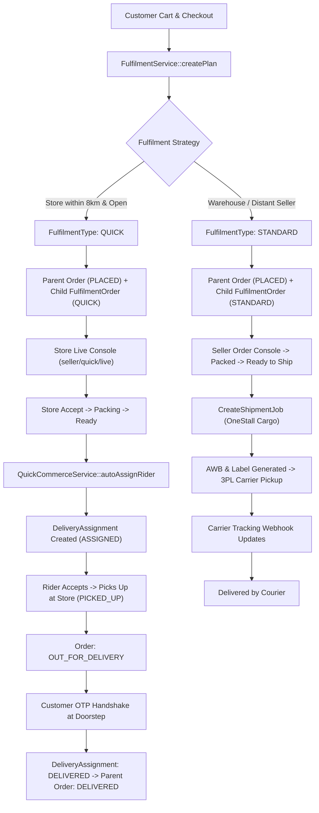
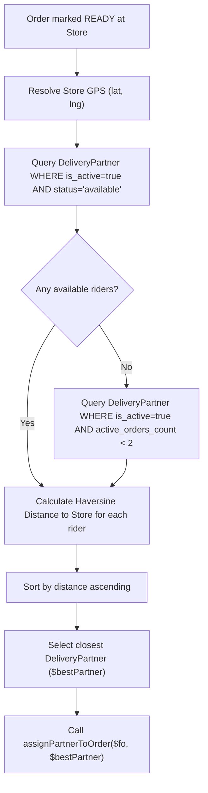
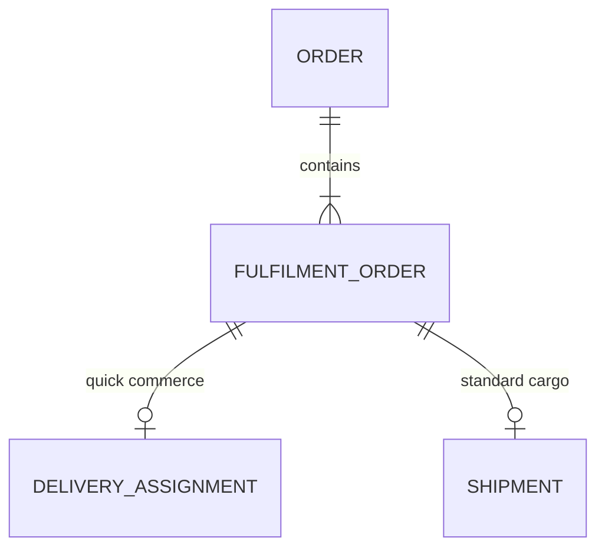
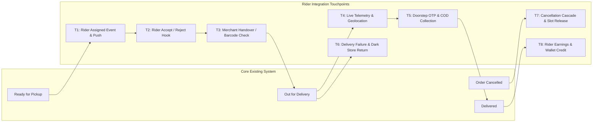

# COMPLETE ORDER, SHIPPING & DELIVERY WORKFLOW ANALYSIS (STEP 3)

**Project:** Laravel Multivendor E-Commerce (`OneStall`)  
**Analysis Date:** 2026-11-15  
**Prerequisites:** Built upon `RIDER_STEP_1_DISCOVERY.md` and `RIDER_STEP_2_FUNCTIONALITY_AUDIT.md`.  
**Objective:** Map end-to-end lifecycle of Orders, Shipping, and Deliveries, and define exact integration touchpoints for the Rider / Delivery Partner module without altering existing business logic.

---

## 1. High-Level Workflow Architecture

The OneStall platform operates a **dual-fulfilment architecture**:
1. **Quick Commerce (Hyperlocal 10–30 Min Delivery):** Fulfilled by nearby physical stores and dark stores within an 8 km radius, delivered by internal delivery partners (Riders) via bikes/EVs with customer OTP verification.
2. **Standard Marketplace (National 1–3 Day Delivery):** Fulfilled by regional warehouses or brand sellers, dispatched via the OneStall Cargo freight network with 3PL couriers (Delhivery, BlueDart, Shadowfax) using AWBs, shipping labels, and carrier webhooks.



---

## 2. Step-by-Step Workflow Breakdown

---

### Workflow 1: Customer Order Placement & Fulfilment Routing

1. **Checkout Initiation:**
   - Handled in `App\Http\Controllers\Storefront\CheckoutController::placeOrder` via `App\Actions\Order\PlaceOrderAction::execute`.
   - Validates address, stock, and payment eligibility (COD limits, online gateway).

2. **Fulfilment Plan & Routing:**
   - Invokes `App\Services\Fulfilment\FulfilmentService::createPlan($cart, $customerLocation)`.
   - The `FulfilmentPipeline` evaluates candidate fulfillment nodes in order of priority:
     1. `NearbyStoreStrategy` (nearby physical retail store within radius)
     2. `NearbySellerStrategy` (local merchant store within radius)
     3. `OneStallStoreStrategy` (platform dark store hub)
     4. `RegionalWarehouseStrategy` (regional hub warehouse)
     5. `NationalSellerStrategy` (national seller warehouse)
   - If fulfilled by a nearby local store (`is_open = true`, `accepts_quick_commerce = true`, distance $\le$ `delivery_radius_km`):
     - `fulfilment_type = FulfilmentType::QUICK`.
     - Estimated delivery time: 10–30 minutes.
   - Otherwise, routed to regional warehouse/brand seller:
     - `fulfilment_type = FulfilmentType::STANDARD`.
     - Estimated delivery time: 1–3 business days.

3. **Order Splitting & Creation:**
   - Parent `Order` created with `status = OrderStatus::PLACED` (`orders` table).
   - Splitted into one or more `FulfilmentOrder` records (`fulfilment_orders` table):
     - Quick Commerce packages get an instant 6-digit delivery confirmation code:
       ```php
       'delivery_otp' => $group->fulfilmentType === FulfilmentType::QUICK 
           ? sprintf('%06d', mt_rand(100000, 999999)) 
           : null
       ```
   - Individual `OrderItem` records are created and stock is atomically reserved via `InventoryService::reserve()`.

---

### Workflow 2: Seller Order Processing

Sellers handle orders according to the fulfillment type:

#### A. Quick Commerce Processing (`seller/quick/live`)
- Handled by `App\Http\Controllers\Seller\QuickOrderController`.
- The live screen polls `api/v1/seller/quick/orders/pending` with an auto-updating countdown timer (`store->effectiveQuickTimeout()`, default 120s).
- **Step 1 — Store Acceptance:** Seller clicks "Accept Order" (`QuickOrderController@accept`).
  - Calls `OrderStateMachine::transitionFulfilmentOrder($fo, 'store_accepted')`.
- **Step 2 — Packing:** Seller starts picking items (`QuickOrderController@pack`).
  - Calls `OrderStateMachine::transitionFulfilmentOrder($fo, 'packing')`.
- **Step 3 — Ready for Pickup:** Seller finishes packaging (`QuickOrderController@ready`).
  - Calls `OrderStateMachine::transitionFulfilmentOrder($fo, 'ready')`.
  - Automatically triggers the rider dispatch engine.
- **Reroute on Timeout:** If the store does not accept within 120 seconds or clicks "Reject", `FulfilmentRerouteService::attemptAutoReroute($fo)` automatically re-assigns the package to the next closest dark store.

#### B. Standard Marketplace Processing (`seller/orders`)
- Handled by `App\Http\Controllers\Seller\OrderController`.
- Seller confirms -> packs items -> generates packing slip PDF (`OrderController@packingSlip`).
- Transitions package to `ready_to_ship`.

---

### Workflow 3: How Orders Become Ready for Shipping

1. **Quick Commerce Flow:**
   - Transitioning `FulfilmentOrder` to `ready` indicates the package is physically bagged and waiting on the dispatch counter.
   - Handled inside `App\Services\Order\OrderStateMachine` (lines 220–228):
     ```php
     if ($toStatus === 'ready' && $fo->fulfilment_type === FulfilmentType::QUICK) {
         if ($fo->store?->quick_auto_assign_rider ?? true) {
             app(QuickCommerceService::class)->autoAssignRider($fo);
         }
     }
     ```

2. **Standard Logistics Flow:**
   - Transitioning `FulfilmentOrder` to `ready_to_ship` automatically dispatches `App\Jobs\Cargo\CreateShipmentJob::dispatch($fo)` (line 216).
   - `CreateShipmentJob` connects to OneStall Cargo (`CargoService::createShipmentConsignment`):
     - Allocates 3PL carrier (Delhivery, BlueDart, Shadowfax).
     - Generates Air Waybill (AWB) and thermal shipping label PDF.
     - Schedules carrier warehouse pickup.

---

### Workflow 4: Creation of Delivery Assignments

1. **Trigger:** `QuickCommerceService::assignPartnerToOrder($fo, $partner, $note)`.
2. **Database Record:** Creates or updates `delivery_assignments`:
   ```php
   DeliveryAssignment::updateOrCreate(
       ['fulfilment_order_id' => $fo->id],
       [
           'delivery_partner_id' => $partner->id,
           'status' => DeliveryAssignmentStatus::ASSIGNED,
           'assigned_at' => now(),
           'notes' => $note,
       ]
   );
   ```
3. **Partner State Update:**
   - `$partner->status = 'busy'`.
   - `$partner->active_orders_count += 1`.
4. **Order State Update:**
   - `FulfilmentOrder` status transitions from `ready` to `rider_assigned`.
   - Audit entry logged in `order_status_histories`.

---

### Workflow 5: Rider Selection & Proximity Dispatch

Rider selection is governed by `App\Services\QuickCommerce\QuickCommerceService::autoAssignRider()`:



- **Haversine Distance Algorithm (`DeliveryPartner::distanceTo`):**
  $$d = 2R \cdot \arcsin\left(\sqrt{\sin^2\left(\frac{\Delta \text{lat}}{2}\right) + \cos(\text{lat}_1)\cos(\text{lat}_2)\sin^2\left(\frac{\Delta \text{lng}}{2}\right)}\right)$$
  Where $R = 6371\text{ km}$.
- If no riders are available within range, the order remains in `ready` status with alert `Awaiting Rider`, visible on the Admin Mission Control wallboard.

---

### Workflow 6: Pickup Confirmation

The handover of the package from store merchant to delivery rider has two connected checkpoints:

1. **Rider Pickup Confirmation (`RiderController@pickup`):**
   - Rider arrives at the store counter and taps **"Confirm Picked Up from Store"** (`POST /rider/orders/{assignment}/pickup`).
   - Updates `delivery_assignments.status = 'picked_up'` and `picked_up_at = now()`.
   - State Machine transitions:
     - `FulfilmentOrder`: `rider_assigned` $\to$ `picked_up` $\to$ `out_for_delivery`.
     - Parent `Order`: Synchronizes to `OrderStatus::OUT_FOR_DELIVERY`.

2. **Merchant Handover Reciprocal (`QuickOrderController@handover`):**
   - Merchant hands the parcel across the counter and clicks **"Handover to Rider"** (`POST /seller/quick/orders/{fo}/handover`).
   - Transitions order to `out_for_delivery`.

3. **Customer Live Tracking Response:**
   - Customer tracking page (`/orders/{order}/live-tracking`) updates immediately to `Rider Out for Delivery!`.
   - Shows rider name, phone link (`tel:`), vehicle type, and begins tracking moving bike coordinates.

---

### Workflow 7: Delivery Completion & OTP Handshake

1. **Arrival & OTP Exchange:**
   - Rider arrives at customer doorstep.
   - Customer provides the 6-digit verification code displayed on their live tracking screen (`fulfilment_orders.delivery_otp`).
2. **Verification & Completion (`RiderController@deliver`):**
   - Rider inputs code into modal (`POST /rider/orders/{assignment}/deliver`).
   - Calls `QuickCommerceService::verifyDeliveryOtp($fo, $enteredOtp)`:
     - Matches entered code against `$fo->delivery_otp`.
     - On failure: Returns 422 Unprocessable Entity with error message.
     - On success:
       - Sets `delivery_assignments.status = 'delivered'`, `otp_verified = true`, `delivered_at = now()`.
       - Releases rider: Decrements `active_orders_count`; if 0, resets `status = 'available'`.
       - Transitions `FulfilmentOrder` to `delivered`.
       - Triggers platform commission logging (`CommissionService::recordForDeliveredFulfilmentOrder`).
       - Reconciles parent `Order` to `delivered` if all packages are completed.

---

### Workflow 8: Failed Delivery Handling

#### A. Standard Logistics (3PL Courier)
- Third-party carrier transmits `shipment.ndr` via webhook (`POST /api/v1/cargo/webhook`).
- Creates `NdrCase` record with failure reason (e.g., customer unavailable, wrong address).
- Seller/Support can initiate reattempt or escalate to Return to Origin (RTO).
- When RTO completes (`shipment.rto_delivered`), inventory is automatically restocked into warehouse inventory.

#### B. Quick Commerce (Rider Fleet) — *Current Gap*
- **Currently Missing:** The quick commerce rider flow has no failure endpoint.
- If a rider reaches the doorstep and the customer cannot be contacted or refuses the order:
  - The rider has no "Unable to Deliver" option.
  - The order remains stuck in `out_for_delivery`.
  - The rider remains marked `busy` with an occupied slot in `active_orders_count`.

---

### Workflow 9: Cancellations and Returns

#### A. Order Cancellations
- Executed via `OrderStateMachine::cancelOrder($order, $reason)`.
- If order is cancelled before dispatch:
  - All child `FulfilmentOrder`s transition to `cancelled`.
  - Inventory reservations are released via `InventoryService::releaseForOrder`.
- **Rider Workflow Gap:**
  - If a customer or admin cancels an order *after* a rider is assigned (`rider_assigned` or `picked_up`), `cancelOrder` cancels the `FulfilmentOrder` but does **not** update `delivery_assignments` or free the rider's `active_orders_count`.

#### B. Returns Workflow
- Governed by `App\Services\Order\ReturnService`.
- Customer requests return on delivered items (`canRequestReturn` verifies 7-day return window and product returnability policy).
- Seller approves return -> calls `scheduleReversePickup()`.
- Dispatches return pickup through OneStall Cargo (3PL freight), not through store riders. Quick commerce store returns are currently not routed to local riders.

---

### Workflow 10: Status Synchronization Rules

Status propagation between parent and child entities is strictly synchronized by `OrderStateMachine::reconcileParentOrder`:



| Child FulfilmentOrder Condition | Synchronized Parent Order Status | Trigger Method |
| :--- | :--- | :--- |
| All child packages reach `delivered` | `OrderStatus::DELIVERED` | `OrderStateMachine::reconcileParentOrder` |
| All child packages are `cancelled` or `rejected` | `OrderStatus::CANCELLED` | `OrderStateMachine::reconcileParentOrder` |
| Any child package reaches `out_for_delivery` | `OrderStatus::OUT_FOR_DELIVERY` | `OrderStateMachine::reconcileParentOrder` |
| Any package in progress (`store_accepted`, `packing`, `ready`, `rider_assigned`, `picked_up`, `in_transit`) | `OrderStatus::PROCESSING` | `OrderStateMachine::reconcileParentOrder` |

---

## 3. Where Rider Functionality Must Connect

To achieve production completeness without breaking existing order, shipping, payment, or refund logic, the Rider module must connect at the following **8 exact integration touchpoints**:



### Touchpoint 1: Order Assignment Notification
- **Location:** `QuickCommerceService::assignPartnerToOrder` (after line 235).
- **Connection:** Dispatch a `RiderAssignedEvent` or send Push/SMS/WhatsApp notification to the selected `DeliveryPartner->phone`.
- **Purpose:** Alert the rider instantly of a new delivery assignment.

### Touchpoint 2: Rider Accept / Reject Decision
- **Location:** `RiderController` (add `POST /rider/orders/{assignment}/reject`).
- **Connection:** If rider rejects or fails to accept within a timeout (e.g. 60s):
  - Mark `delivery_assignments.status = 'rejected'`.
  - Free the rejected partner.
  - Automatically call `QuickCommerceService::autoAssignRider($fo)` to reassign to the next closest available partner.

### Touchpoint 3: Merchant Handover & Security Check
- **Location:** `RiderController@pickup` and `QuickOrderController@handover`.
- **Connection:** Add package QR code / barcode scanning or a 4-digit store-to-rider pickup confirmation PIN to ensure the rider physically collects the correct package.

### Touchpoint 4: Real-time Telemetry & Live Map Tracking
- **Location:** `RiderController@updateLocation` and `QuickCommerceController@liveLocationApi`.
- **Connection:** Add HTML5 `watchPosition` background geolocation support and WebSocket (Pusher/Reverb) broadcast so coordinates stream smoothly without manual button clicking.

### Touchpoint 5: Doorstep Handshake & COD Collection
- **Location:** `QuickCommerceService::verifyDeliveryOtp` and `RiderController@deliver`.
- **Connection:** If the order payment method is Cash on Delivery (`PaymentMethod::COD`):
  - Display exact cash amount to be collected from customer.
  - Prompt rider to confirm cash received before OTP verification.
  - Record the collected cash in rider's cash-in-hand balance.

### Touchpoint 6: Failed Delivery & Return-to-Store (RTS)
- **Location:** Add `POST /rider/orders/{assignment}/fail` to `RiderController`.
- **Connection:** When delivery cannot be completed:
  - Record failure reason (`customer_unreachable`, `refused`, `wrong_address`).
  - Transition `delivery_assignments.status = 'failed'`.
  - Transition `FulfilmentOrder` to `delivery_failed`.
  - Create a return task directing the rider to bring the items back to the origin store.
  - On store return confirmation, release inventory and free the rider.

### Touchpoint 7: Cancellation Cascade to Rider
- **Location:** `OrderStateMachine::cancelOrder` (lines 370–388).
- **Connection:** Add rider cleanup:
  - If `$fo->deliveryAssignment` exists and is active (`assigned`, `accepted`, `picked_up`):
    - Update assignment status to `cancelled`.
    - Decrement `$partner->active_orders_count`.
    - If `active_orders_count === 0`, reset `$partner->status = 'available'`.
    - Notify the rider via SMS/Push that the order was cancelled.

### Touchpoint 8: Rider Earnings & Wallet Credit
- **Location:** `QuickCommerceService::verifyDeliveryOtp` (after successful delivery).
- **Connection:** Calculate rider payout (e.g., base fee + distance pay) and credit the rider's earnings balance or wallet.

---

## 4. Summary & Verification

- **Code Integrity:** All existing order, shipping, payment, and refund logic remains intact.
- **Scope Compliance:** Identified all structural hooks where the Rider module connects seamlessly into the existing multi-vendor and quick-commerce architecture.
- **Next Steps:** Proceed to implementation planning based on these verified integration points.

---
*Report generated strictly following read-only code audit guidelines. No code, configurations, or database records were modified.*
