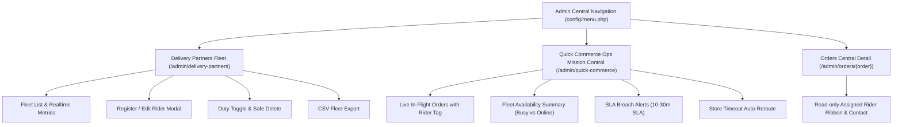

# ADMIN PANEL RIDER MANAGEMENT AUDIT (STEP 4)

**Project:** Laravel Multivendor E-Commerce (`OneStall`)  
**Audit Date:** 2026-11-15  
**Target Focus:** Admin Central Console capabilities specifically for Rider / Delivery Partner Fleet Management.  
**Prerequisites:** Builds upon Steps 1, 2, and 3.

---

## 1. Executive Summary & Screen Inventory

The OneStall Admin Panel currently houses two dedicated operational screens that directly interface with the Rider / Delivery Partner ecosystem:
1. **Delivery Partners Fleet Console (`/admin/delivery-partners`):** Managed by `App\Http\Controllers\Admin\DeliveryPartnerController` and rendered via [`resources/views/admin/delivery-partners/index.blade.php`](file:///c:/xampp/htdocs/multivendorecommercenew/resources/views/admin/delivery-partners/index.blade.php).
2. **Quick Commerce Mission Control (`/admin/quick-commerce`):** Managed by `App\Http\Controllers\Admin\QuickCommerceOpsController` and rendered via [`resources/views/admin/quick-commerce/index.blade.php`](file:///c:/xampp/htdocs/multivendorecommercenew/resources/views/admin/quick-commerce/index.blade.php).
3. **Order Detail View (`/admin/orders/{order}`):** Rendered via [`resources/views/admin/orders/show.blade.php`](file:///c:/xampp/htdocs/multivendorecommercenew/resources/views/admin/orders/show.blade.php) featuring a read-only logistics ribbon for quick-commerce packages.



---

## 2. Detailed Checklist & Audit Findings

---

### 1. Rider Listing
- **Status:** `Working and Verified`
- **Route:** `GET /admin/delivery-partners` (`admin.delivery_partners.index`)
- **Controller:** `App\Http\Controllers\Admin\DeliveryPartnerController::index`
- **View:** `resources/views/admin/delivery-partners/index.blade.php`
- **Functionality Present:**
  - **Metrics Strip:** 5 realtime metric counters at top:
    - *Total Fleet:* Total registered delivery partners count (`DeliveryPartner::count()`).
    - *Available & Online:* `status = 'available'` and `is_active = true`.
    - *Busy / On Delivery:* `status = 'busy'`.
    - *Offline / Off-Duty:* `status = 'offline'` or `is_active = false`.
    - *Total Deliveries:* Completed assignments count (`DeliveryAssignment::where('status', 'delivered')->count()`).
  - **Search & Filters:**
    - Live search across `name`, `phone`, and `vehicle_number`.
    - Filter dropdown by duty status (`available`, `busy`, `offline`).
    - Filter dropdown by vehicle type (`Electric Scooter`, `Motorcycle`, `Bicycle`, `Van`).
  - **Table Columns:**
    - *Rider Profile:* Avatar with initial, Name, and unique `#ID`.
    - *Phone / Contact:* Clickable `tel:` link and "SMS / OTP Verified" badge.
    - *Vehicle Fleet:* Vehicle type and plate registration number.
    - *Duty Status:* Interactive badge showing status with pulsating status light.
    - *Live GPS Position:* Formatted lat/long with direct link to Google Maps (`https://www.google.com/maps?q={lat},{lng}`) and relative update timestamp (`$rider->last_location_updated_at->diffForHumans()`).
    - *Active Jobs:* Number of in-flight orders (`active_orders_count`).
    - *Deliveries Count:* Aggregated lifetime deliveries (`assignments_count`).
    - *Actions:* Edit profile button and Delete button.
  - **Pagination:** 15 riders per page with query string preservation (`->withQueryString()`).
  - **Automated Test Coverage:** Tested and verified in `tests/Feature/AdminDeliveryPartnersTest.php` (tests pass).

---

### 2. Add / Edit Rider
- **Status:** `Working and Verified (with User account gap)`
- **Routes:**
  - `POST /admin/delivery-partners` (`admin.delivery_partners.store`)
  - `PUT /admin/delivery-partners/{deliveryPartner}` (`admin.delivery_partners.update`)
- **Controller:** `DeliveryPartnerController@store` & `@update`
- **UI:** Single responsive Alpine.js modal (`rider-modal`) handling both Create and Edit modes seamlessly.
- **Validation Rules:**
  - `name`: Required, string, max 100 characters.
  - `phone`: Required, string, max 20, unique in `delivery_partners` (ignores current ID on update).
  - `vehicle`: Required, in `Electric Scooter`, `Motorcycle`, `Bicycle`, `Van`.
  - `vehicle_number`: Nullable, string, max 30.
  - `status`: Nullable, in `available`, `busy`, `offline`.
  - `current_lat`: Nullable, numeric between -90 and 90 (defaults to 12.9716).
  - `current_lng`: Nullable, numeric between -180 and 180 (defaults to 77.5946).
  - `is_active`: Nullable, boolean.
- **Gaps Identified:**
  - **No User Account Created:** When creating a rider via `store()`, only a record in `delivery_partners` is created with `user_id = null`. It does **not** create a record in `users`, nor does it assign a login password or Spatie role. The rider cannot log in using credentials unless an admin seeds or binds an existing user ID manually.

---

### 3. Rider Approval and Rejection
- **Status:** `Missing`
- **What Exists:**
  - None.
- **What is Missing:**
  - There is **no approval workflow** in the Admin panel.
  - Riders created by Admin are immediately set to `is_active = true` and `status = 'available'`.
  - There is no `approval_status` column (e.g., `pending`, `under_review`, `approved`, `rejected`), no pending applicant queue, and no admin button to approve or reject riders.
  - No rejection reason tracking.

---

### 4. Rider Activation and Deactivation
- **Status:** `Working and Verified`
- **Route:** `POST /admin/delivery-partners/{deliveryPartner}/toggle` (`admin.delivery_partners.toggle`)
- **Controller:** `DeliveryPartnerController@toggleStatus`
- **Functionality Present:**
  - **One-Click Inline Toggle:** Clicking the status badge directly in the table row sends an AJAX/form POST to toggle between Online (`available`) and Offline (`offline`).
  - **Explicit Duty Update:** Accepts `status` input (`available`, `busy`, `offline`) and automatically synchronizes `is_active` (`is_active = ($status !== 'offline')`).
  - **Retirement / Deletion Safeguards:**
    - Route: `DELETE /admin/delivery-partners/{deliveryPartner}` (`admin.delivery_partners.destroy`).
    - The controller explicitly checks:
      ```php
      $hasActiveJobs = $deliveryPartner->assignments()
          ->whereIn('status', ['assigned', 'accepted', 'picked_up'])
          ->exists();
      if ($hasActiveJobs || $deliveryPartner->active_orders_count > 0) {
          return back()->with('error', "Cannot delete rider '{$deliveryPartner->name}' because they have active delivery assignments in progress.");
      }
      ```
    - The delete button in the UI is disabled if `active_orders_count > 0`.
  - **Test Coverage:** Verified by `test_admin_can_toggle_delivery_partner_duty_status` and `test_admin_cannot_delete_rider_with_active_assignments`.

---

### 5. Rider Profile and Document Verification
- **Status:** `Incomplete / Partially Implemented`
- **What Exists:**
  - Contact and vehicle metadata are editable via the edit modal (`name`, `phone`, `vehicle`, `vehicle_number`, coordinates).
- **What is Missing:**
  - **No Document Uploads:** No file inputs for Driving License (front & back), Vehicle Registration Certificate (RC), Vehicle Commercial Insurance, or Aadhaar / PAN identity cards.
  - **No Verification State:** No document review screen, no "Approve Documents" button, and no expiry date alerts for driving licenses or insurance.
  - **Static Text Only:** The table shows a hardcoded label `"SMS / OTP Verified"` under the phone number without an underlying database verification timestamp.

---

### 6. Order Assignment and Reassignment
- **Status:** `Missing on Admin Side (Seller side only)`
- **What Exists:**
  - **Store Auto-Reroute:** Admin can trigger auto-reroute to another store via `POST /admin/quick-commerce/{fo}/reroute` if a store times out.
  - **Read-only Order Ribbon:** In `/admin/orders/{order}`, Admin can see which rider is assigned:
    ```blade
    🚴 Assigned Rider: {{ $rider->name }} ({{ $rider->phone }}) • {{ $rider->vehicle_number }}
    ```
- **What is Missing on Admin Side:**
  - Admin **cannot manually assign a rider** to an unassigned order from the Admin panel.
  - Admin **cannot reassign or replace an existing rider** (e.g., if a rider's vehicle breaks down or the rider is unresponsive).
  - Manual assignment is currently only implemented on the **Seller** side (`POST /seller/orders/{fulfilmentOrder}/assign-rider`).

---

### 7. Delivery Monitoring
- **Status:** `Working and Verified`
- **Route:** `GET /admin/quick-commerce` (`admin.quick.index`)
- **Controller:** `App\Http\Controllers\Admin\QuickCommerceOpsController::index`
- **View:** `resources/views/admin/quick-commerce/index.blade.php`
- **Functionality Present:**
  - **Mission Control Wallboard:**
    - Shows in-flight packages in real time with elapsed minutes.
    - Displays assigned rider partner badge next to store name.
    - Flags packages awaiting rider dispatch (`Awaiting Rider`).
    - Monitors fleet capacity: Available vs Total riders counter (`ops.riders_summary.available / total`) and active deliveries count (`busy`).
    - SLA Health Monitor: Alerts if store acceptance times or rider transit times exceed 10–30 minute thresholds.
  - **JSON Telemetry Feed:** `GET /admin/quick-commerce/api-feed` returns real-time JSON payload for automated monitoring screens or external wall displays.
  - **Coordinates Monitoring:** Admin fleet table displays exact latitude, longitude, and relative update time for every rider.

---

### 8. Failed Delivery Management
- **Status:** `Missing for Rider Fleet`
- **What Exists:**
  - Standard 3PL Logistics: `/admin/shipping/failed-queue` exists for 3PL consignments that failed AWB generation or carrier dispatch.
- **What is Missing for Quick Commerce:**
  - No failed delivery queue for hyperlocal riders.
  - If a rider arrives at the destination and the customer is unreachable, there is no exception logged in Admin Central.
  - Admin cannot view a list of failed doorstep deliveries, view rider remarks, or instruct a return to store.

---

### 9. Rider Earnings
- **Status:** `Missing`
- **What Exists:**
  - None for delivery partners. (The existing `Admin/SettlementController` strictly manages `SellerSettlement` payouts for merchant vendors).
- **What is Missing:**
  - No Admin screen for Rider Earnings or Payouts.
  - No configuration for rider payout rates (e.g. Base payout ₹30 + ₹10/km after 3 km + ₹15 rain/night surge).
  - No rider ledger, tips tracking, or bank payout generation.

---

### 10. Rider Reports
- **Status:** `Partially Implemented`
- **What Exists:**
  - **Fleet CSV Export:**
    - Route: `GET /admin/delivery-partners/export` (`admin.delivery_partners.export`).
    - Controller: `DeliveryPartnerController@export`.
    - Streams a comprehensive CSV containing: `ID`, `Rider Name`, `Phone`, `Vehicle Type`, `Vehicle Number`, `Duty Status`, `Is Active`, `Active Orders`, `Total Completed`, `Latitude`, `Longitude`, `Registered At`.
    - Filters applied in UI (search, status, vehicle) are preserved in the export.
  - **Sales Delivery Revenue:** `Admin/ReportController` tracks `delivery_fee` totals in sales reports.
- **What is Missing:**
  - **Rider Performance & SLA Analytics:** No report tracking:
    - Average delivery turnaround time per rider.
    - On-time delivery SLA compliance percentage (10–30m target).
    - Rider rejection rate / cancellation rate.
    - Total kilometers logged.
    - Customer delivery ratings / feedback.

---

### 11. Permissions and Access Control
- **Status:** `Incomplete / Security Policy Discrepancy`
- **What Exists:**
  - The entire `/admin/delivery-partners` route group in `routes/admin.php` is protected by:
    ```php
    Route::middleware(['auth', 'role:super_admin|admin|support_admin'])
    ```
  - Spatie permissions list in `RolesAndPermissionsSeeder.php` defines:
    - `cargo.view`
    - `cargo.manage`
    - `cargo.assign_rider`
    - `cargo.update_status`
- **Security Discrepancies & Gaps Identified:**
  - **Missing Controller Authorization:** `DeliveryPartnerController` has **no `$this->authorize(...)` checks** or permission middleware on its actions.
  - **Support Admin Over-Privilege:** Because the outer route group permits `role:super_admin|admin|support_admin`, any user with the `support_admin` role can access the fleet console, edit rider details, toggle duty status, and delete riders.
  - **Contradiction with Seeder:** In `RolesAndPermissionsSeeder.php`, `support_admin` is **not** granted `cargo.manage` or `cargo.assign_rider`. However, due to the lack of method-level permission checks in `DeliveryPartnerController`, the role check at the route group level inadvertently allows them full administrative write access.

---

## 3. Summary Audit Matrix

| Feature Area | Working / Verified | Incomplete | Missing | Notes |
| :--- | :---: | :---: | :---: | :--- |
| **1. Rider Listing** | **YES** | - | - | Search, filters, metrics, pagination, and tests all pass. |
| **2. Add / Edit Rider** | **YES** | YES | - | Form & CRUD work, but does not create `User` login credentials. |
| **3. Rider Approval & Rejection** | - | - | **YES** | No approval queue, KYC review, or status machine. |
| **4. Rider Activation / Deactivation** | **YES** | - | - | Instant toggle works; active order deletion protection verified. |
| **5. Rider Profile & Documents** | - | YES | - | Metadata editable; document uploads & verification missing. |
| **6. Order Assignment / Reassignment** | - | - | **YES** | Admin has read-only ribbon; cannot manually assign or reassign. |
| **7. Delivery Monitoring** | **YES** | - | - | Realtime ops wallboard, flight timer, and JSON feed work. |
| **8. Failed Delivery Management** | - | - | **YES** | Missing for quick commerce rider fleet. |
| **9. Rider Earnings** | - | - | **YES** | No payout tracking, rates, or ledger in Admin. |
| **10. Rider Reports** | - | YES | - | Fleet CSV export works; SLA performance analytics missing. |
| **11. Permissions & Access Control** | - | YES | - | Outer role check works; granular controller permissions missing. |

---

## 4. Recommendations for Next Implementation Steps

To achieve complete, enterprise-grade Rider Management in Admin Central without duplicating screens:
1. **Enhance Add/Edit Modal:** Add user account provisioning (auto-create linked `users` record with role `delivery_staff` and SMS welcome credentials) and document file uploads (DL, RC, Insurance).
2. **Implement Approval Workflow:** Add an approval status badge (`Pending Review`, `Approved`, `Suspended`) with Admin "Approve" and "Reject" buttons.
3. **Add Admin Manual Assignment & Override:** On `/admin/orders/{order}` and `/admin/quick-commerce`, add an "Assign / Reassign Rider" button with an active nearby rider selector modal.
4. **Implement Granular Permissions:** Add `$this->authorize('cargo.manage')` checks in `DeliveryPartnerController` to enforce strict Super Admin / Logistics Admin separation.
5. **Rider Performance Tab:** Add a tab or sub-view to `/admin/delivery-partners` for delivery SLA analytics (turnaround times, on-time rates, and completed deliveries leaderboard).

---
*Report generated strictly following read-only code audit guidelines. No code, configurations, or database records were modified.*
