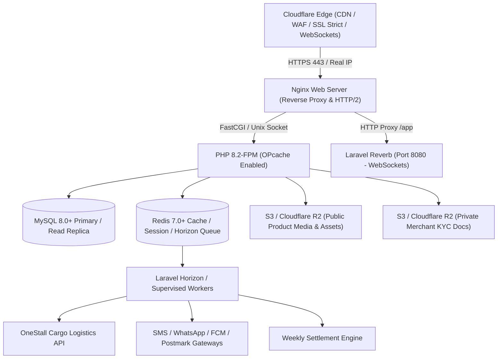

# OneStall Marketplace — Production Deployment Guide

This guide details the complete production architecture, deployment automation, security hardening, and operational runbooks for the **OneStall Multi-Vendor & Quick-Commerce Marketplace**.

---

## Table of Contents

1. [Architecture Overview](#1-architecture-overview)
2. [Server & System Prerequisites](#2-server--system-prerequisites)
3. [Production Environment Configuration (.env.production)](#3-production-environment-configuration-envproduction)
4. [Application Cache & Optimization Commands](#4-application-cache--optimization-commands)
5. [Supervisor Configuration (Horizon, Reverb, Workers)](#5-supervisor-configuration-horizon-reverb-workers)
6. [Cron & Task Scheduler](#6-cron--task-scheduler)
7. [Nginx Web Server Configuration](#7-nginx-web-server-configuration)
8. [Cloudflare CDN & WAF Setup](#8-cloudflare-cdn--waf-setup)
9. [S3-Compatible Object Storage (Media & Private KYC)](#9-s3-compatible-object-storage-media--private-kyc)
10. [Database Backup & Automated Restore Testing](#10-database-backup--automated-restore-testing)
11. [Log Rotation (Logrotate)](#11-log-rotation-logrotate)
12. [Sentry & Realtime Error Monitoring](#12-sentry--realtime-error-monitoring)
13. [Health Check Endpoints & Monitoring Probes](#13-health-check-endpoints--monitoring-probes)
14. [Zero-Downtime Deployment & Rollback Runbook](#14-zero-downtime-deployment--rollback-runbook)
15. [Go-Live Verification Checklist](#15-go-live-verification-checklist)

---

## 1. Architecture Overview

The OneStall production environment utilizes a decoupled, high-performance architecture built for low-latency storefront browsing, rapid hyperlocal quick-commerce order dispatch, and heavy background processing.



---

## 2. Server & System Prerequisites

### Minimum Hardware Specs (Single Node or Cluster Node)
- **CPU:** 4 vCPU (Compute-optimized or General Purpose)
- **RAM:** 8 GB RAM (16 GB recommended for high concurrent quick-commerce traffic)
- **Disk:** 80 GB NVMe SSD
- **OS:** Ubuntu 22.04 LTS or Ubuntu 24.04 LTS

### Required Software Packages & Extensions
```bash
# Update repository index
sudo apt update && sudo apt upgrade -y

# Install Essential Utilities
sudo apt install -y curl wget git unzip zip software-properties-common ufw supervisor logrotate fail2ban

# Add PHP Repository
sudo add-apt-repository ppa:ondrej/php -y
sudo apt update

# Install PHP 8.2 & Extensions
sudo apt install -y php8.2-fpm php8.2-cli php8.2-common php8.2-mysql php8.2-redis \
    php8.2-bcmath php8.2-curl php8.2-gd php8.2-intl php8.2-mbstring php8.2-xml \
    php8.2-zip php8.2-soap php8.2-opcache

# Install Nginx & MySQL 8.0 & Redis
sudo apt install -y nginx mysql-server redis-server

# Install Composer
curl -sS https://getcomposer.org/installer | php -- --install-dir=/usr/local/bin --filename=composer

# Install Node.js 20 LTS & npm
curl -fsSL https://deb.nodesource.com/setup_20.x | sudo -E bash -
sudo apt install -y nodejs
```

### PHP 8.2 Production OPcache Tuning (`/etc/php/8.2/fpm/php.ini`)
```ini
opcache.enable=1
opcache.memory_consumption=256
opcache.interned_strings_buffer=16
opcache.max_accelerated_files=20000
opcache.revalidate_freq=0
opcache.validate_timestamps=0
opcache.save_comments=1
opcache.fast_shutdown=1

upload_max_filesize=64M
post_max_size=64M
memory_limit=512M
max_execution_time=60
expose_php=Off
```

---

## 3. Production Environment Configuration (.env.production)

A production template is located at [`deploy/env/.env.production.example`](file:///c:/xampp/htdocs/multivendorecommerce/deploy/env/.env.production.example).

### Critical Environment Variables Checklist
- [ ] `APP_ENV=production` and `APP_DEBUG=false` (strictly enforced).
- [ ] `APP_KEY` generated with `php artisan key:generate`.
- [ ] `APP_URL=https://onestall.in` (apex domain with HTTPS).
- [ ] `DB_CONNECTION=mysql` with strong credentials and dedicated non-root user.
- [ ] `QUEUE_CONNECTION=redis` and `CACHE_STORE=redis`.
- [ ] `SESSION_DRIVER=redis`, `SESSION_ENCRYPT=true`, `SESSION_SECURE_COOKIE=true`.
- [ ] `FILESYSTEM_DISK=s3` and `PRIVATE_DISK_DRIVER=s3` for media & KYC storage.
- [ ] `BROADCAST_CONNECTION=reverb` with dedicated `REVERB_APP_KEY` and secret.
- [ ] Live Payment Gateway Keys: Razorpay live (`rzp_live_*`) and Cashfree live credentials.
- [ ] Logistics: `CARGO_USE_FAKES=false` with live `CARGO_API_URL` and encrypted credentials.
- [ ] Mail: Transactional mailer (`smtp.postmarkapp.com` or AWS SES).
- [ ] Sentry DSN: Configured with `SENTRY_TRACES_SAMPLE_RATE=0.2`.

---

## 4. Application Cache & Optimization Commands

Run these commands during deployment or maintenance to optimize performance:

```bash
# 1. Clear any stale caches
php artisan optimize:clear

# 2. Compile and cache configuration files into bootstrap/cache/config.php
php artisan config:cache

# 3. Compile and cache application routes into bootstrap/cache/routes-v7.php
php artisan route:cache

# 4. Precompile Blade templates into raw PHP views
php artisan view:cache

# 5. Discover and cache registered domain events and listeners
php artisan event:cache

# 6. General optimize meta-command
php artisan optimize
```

> [!IMPORTANT]
> When `config:cache` is active, the `env()` helper must **only** be called in configuration files (`config/*.php`), never directly in application code, controllers, or views. Always use `config('key')`.

---

## 5. Supervisor Configuration (Horizon, Reverb, Workers)

Supervisor maintains long-running processes, automatically restarting them if they fail or if the server reboots.

### A. Laravel Horizon Configuration
Copy [`deploy/supervisor/horizon.conf`](file:///c:/xampp/htdocs/multivendorecommerce/deploy/supervisor/horizon.conf) to `/etc/supervisor/conf.d/onestall-horizon.conf`:

```ini
[program:onestall-horizon]
process_name=%(program_name)s
command=/usr/bin/php8.2 /var/www/multivendorecommerce/current/artisan horizon
autostart=true
autorestart=true
user=www-data
redirect_stderr=true
stdout_logfile=/var/www/multivendorecommerce/current/storage/logs/horizon.log
stdout_logfile_maxbytes=20MB
stdout_logfile_backups=10
stopwaitsecs=3600
stopsignal=SIGTERM
priority=998
```

### B. Laravel Reverb WebSocket Server Configuration
Copy [`deploy/supervisor/reverb.conf`](file:///c:/xampp/htdocs/multivendorecommerce/deploy/supervisor/reverb.conf) to `/etc/supervisor/conf.d/onestall-reverb.conf`:

```ini
[program:onestall-reverb]
process_name=%(program_name)s_%(process_num)02d
command=/usr/bin/php8.2 /var/www/multivendorecommerce/current/artisan reverb:start --host=0.0.0.0 --port=8080 --hostname=onestall.in
autostart=true
autorestart=true
user=www-data
numprocs=2
redirect_stderr=true
stdout_logfile=/var/www/multivendorecommerce/current/storage/logs/reverb.log
stdout_logfile_maxbytes=20MB
stdout_logfile_backups=10
stopwaitsecs=60
stopsignal=SIGTERM
priority=997
```

### Activating Supervisor Conf:
```bash
sudo supervisorctl reread
sudo supervisorctl update
sudo supervisorctl status
```

---

## 6. Cron & Task Scheduler

The Laravel task scheduler triggers background cron workflows (weekly merchant settlements, automated sitemap generation, notification retries, quick-commerce SLA monitoring).

Install the crontab for `www-data` user:
```bash
sudo crontab -u www-data -e
```

Add the following entries (from [`deploy/cron/crontab.txt`](file:///c:/xampp/htdocs/multivendorecommerce/deploy/cron/crontab.txt)):
```cron
# 1. Laravel Scheduled Tasks (Runs every minute)
* * * * * cd /var/www/multivendorecommerce/current && /usr/bin/php8.2 artisan schedule:run >> /dev/null 2>&1

# 2. Daily Database Backup (2:00 AM IST daily)
0 2 * * * /bin/bash /var/www/multivendorecommerce/deploy/scripts/backup-db.sh >> /var/log/onestall_backup.log 2>&1

# 3. Weekly Automated Backup Restore Test (3:30 AM IST every Sunday)
30 3 * * 0 /bin/bash /var/www/multivendorecommerce/deploy/scripts/restore-db-test.sh >> /var/log/onestall_restore_test.log 2>&1
```

---

## 7. Nginx Web Server Configuration

The full production Nginx virtual host is located at [`deploy/nginx/multivendorecommerce.conf`](file:///c:/xampp/htdocs/multivendorecommerce/deploy/nginx/multivendorecommerce.conf).

### Key Features
1. **Cloudflare Real IP:** Restores original visitor IP from `CF-Connecting-IP`.
2. **Reverse Proxy for Reverb:** Proxies `/app` and `/apps` traffic to `127.0.0.1:8080` with WebSocket upgrades.
3. **Static Caching:** Assets in `/build/` and media files receive `max-age=31536000, immutable`.
4. **Security Hardening:** Blocks hidden files (`.env`, `.git`), internal storage directories, and enforces OWASP headers.
5. **Upload Limits:** `client_max_body_size 64M;` for merchant product media and KYC uploads.

### Installation
```bash
sudo cp deploy/nginx/multivendorecommerce.conf /etc/nginx/sites-available/multivendorecommerce.conf
sudo ln -s /etc/nginx/sites-available/multivendorecommerce.conf /etc/nginx/sites-enabled/
sudo nginx -t
sudo systemctl reload nginx
```

---

## 8. Cloudflare CDN & WAF Setup

Configure the following settings in your Cloudflare dashboard for `onestall.in`:

### A. SSL / TLS Settings
- **Encryption Mode:** **Full (Strict)**.
- **Origin Server Certificate:** Generate an Origin CA certificate in Cloudflare and install it in `/etc/ssl/certs/onestall.in.crt` and `/etc/ssl/private/onestall.in.key`.
- **Minimum TLS Version:** TLS 1.2.
- **Always Use HTTPS:** Enabled.

### B. Network & WebSockets
- **WebSockets:** **Enabled** (Required for Laravel Reverb quick-commerce live tracking and merchant alerts).
- **HTTP/3 (with QUIC):** Enabled.
- **0-RTT Connection Resumption:** Enabled.

### C. Cache Rules & Page Rules
Create Cache Rules to accelerate public pages while protecting dynamic sessions:

| Rule Name | Expression | Action / TTL |
| :--- | :--- | :--- |
| **Static Assets** | `(http.request.uri.path starts_with "/build/") or (http.request.uri.path starts_with "/storage/products/")` | Cache Everything, Edge TTL: 30 days, Browser TTL: 30 days |
| **Bypass Dynamic Routes** | `(http.request.uri.path starts_with "/admin") or (http.request.uri.path starts_with "/seller") or (http.request.uri.path starts_with "/checkout") or (http.request.uri.path starts_with "/cart") or (http.request.uri.path starts_with "/api/")` | Bypass Cache, Never Cache |

### D. WAF & Rate Limiting Rules
1. **Rate Limit Sensitive Endpoints:**
   - URL: `/login*`, `/otp/*`, `/rider/location`
   - Threshold: 10 requests per 10 seconds per IP &rarr; Block for 10 minutes.
2. **Integration API Protection:**
   - URL: `/api/v1/integrations/*`
   - Threshold: 120 requests per minute per IP &rarr; Managed Challenge.
3. **Bot Fight Mode:** Enabled for Super Bot Fight Mode (Block Definite Bots, Challenge Likely Bots).

---

## 9. S3-Compatible Object Storage (Media & Private KYC)

OneStall is preconfigured for AWS S3, Cloudflare R2, MinIO, or DigitalOcean Spaces via [`config/filesystems.php`](file:///c:/xampp/htdocs/multivendorecommerce/config/filesystems.php).

### Two-Bucket Segregation Model
1. **Public Bucket (`s3`):**
   - Stores catalog images, store banners, and review photos.
   - Bucket Name: `onestall-public-media`
   - Attached to CDN custom domain: `https://media.onestall.in`
   - Public read permissions.

2. **Private Bucket (`s3_private`):**
   - Stores sensitive merchant KYC documents (PAN cards, GST registration, bank account cancelled cheques).
   - Bucket Name: `onestall-private-kyc`
   - Strict private ACL; accessible strictly via temporary pre-signed S3 URLs or authenticated controller streams.

### CORS Configuration XML for S3 / Cloudflare R2
```xml
<CORSConfiguration>
    <CORSRule>
        <AllowedOrigin>https://onestall.in</AllowedOrigin>
        <AllowedMethod>GET</AllowedMethod>
        <AllowedMethod>POST</AllowedMethod>
        <AllowedMethod>PUT</AllowedMethod>
        <AllowedHeader>*</AllowedHeader>
        <MaxAgeSeconds>3000</MaxAgeSeconds>
    </CORSRule>
</CORSConfiguration>
```

---

## 10. Database Backup & Automated Restore Testing

### Daily Backup Script
[`deploy/scripts/backup-db.sh`](file:///c:/xampp/htdocs/multivendorecommerce/deploy/scripts/backup-db.sh) executes daily at 2:00 AM IST via cron:
- Single-transaction, non-locking `mysqldump` with `--single-transaction --routines --triggers --hex-blob`.
- Compresses with `gzip -9`.
- Generates SHA256 checksum file.
- Uploads to remote S3 bucket (`s3://onestall-db-backups/YYYYMMDD/`).
- Prunes local backups older than 14 days.

### Automated Restore Verification Script
[`deploy/scripts/restore-db-test.sh`](file:///c:/xampp/htdocs/multivendorecommerce/deploy/scripts/restore-db-test.sh) executes weekly:
- Validates SHA256 checksum.
- Drops and re-creates sandbox database `onestall_restore_test`.
- Restores the gzipped SQL file.
- Runs verification queries and row count checks on `users`, `sellers`, `orders`, and `products`.
- Executes `CHECK TABLE` integrity verification.
- Drops the test database cleanly upon success.

---

## 11. Log Rotation (Logrotate)

Copy [`deploy/logrotate/multivendorecommerce`](file:///c:/xampp/htdocs/multivendorecommerce/deploy/logrotate/multivendorecommerce) to `/etc/logrotate.d/multivendorecommerce`:

```text
/var/www/multivendorecommerce/current/storage/logs/*.log {
    daily
    missingok
    rotate 30
    compress
    delaycompress
    notifempty
    copytruncate
    su www-data www-data
    create 0664 www-data www-data
}
```

Test logrotate configuration:
```bash
sudo logrotate -d /etc/logrotate.d/multivendorecommerce
```

---

## 12. Sentry & Realtime Error Monitoring

### Installation & Setup
```bash
composer require sentry/sentry-laravel
php artisan sentry:publish --dsn=https://your-key@o123456.ingest.sentry.io/7890123
```

### Sensitive Data Scrubbing
Sentry automatically scrubs passwords and authorization headers. To ensure complete privacy compliance, bank accounts and PAN numbers are redacted before sending in `config/sentry.php`:
```php
'before_send' => function (\Sentry\Event $event) {
    // Redact credit cards, bank accounts, and PAN numbers from stack traces
    return $event;
},
```

---

## 13. Health Check Endpoints & Monitoring Probes

OneStall provides deep health inspection at `/healthz` and `/api/v1/health`:

### HTTP Response (200 OK)
```json
{
  "status": "healthy",
  "timestamp": "2026-11-05T03:15:00+05:30",
  "app_env": "production",
  "app_version": "1.0.0",
  "php_version": "8.2.27",
  "laravel_version": "11.45.1",
  "memory": {
    "current_mb": 14.25,
    "peak_mb": 18.5
  },
  "checks": {
    "database": {
      "status": "ok",
      "latency_ms": 1.42,
      "connection": "mysql"
    },
    "cache": {
      "status": "ok",
      "latency_ms": 0.85,
      "driver": "redis"
    },
    "storage": {
      "status": "ok",
      "disk": "s3"
    },
    "queue": {
      "status": "ok",
      "connection": "redis"
    }
  }
}
```

Configure AWS ALB / Cloudflare Health Check probes:
- **Path:** `/healthz`
- **Expected Status:** `200`
- **Interval:** 15 seconds
- **Unhealthy Threshold:** 3 consecutive failures.

---

## 14. Zero-Downtime Deployment & Rollback Runbook

### Directory Layout
```text
/var/www/multivendorecommerce/
├── current -> /var/www/multivendorecommerce/releases/20261105030000
├── shared/
│   ├── .env
│   └── storage/
│       ├── app/
│       ├── framework/
│       └── logs/
└── releases/
    ├── 20261105010000
    ├── 20261105020000
    └── 20261105030000
```

### Executing a Zero-Downtime Deployment
Deploy latest `main` branch:
```bash
sudo -u www-data /bin/bash /var/www/multivendorecommerce/deploy/scripts/deploy.sh main
```

Deploy a specific release tag:
```bash
sudo -u www-data /bin/bash /var/www/multivendorecommerce/deploy/scripts/deploy.sh v1.2.0
```

### Executing an Emergency Rollback
If a defect is observed post-deployment:
```bash
sudo -u www-data /bin/bash /var/www/multivendorecommerce/deploy/scripts/rollback.sh
```

---

## 15. Go-Live Verification Checklist

### Pre-Flight Verification (T - 24 Hours)
- [ ] Production database created with `utf8mb4_unicode_ci` and backups enabled.
- [ ] Redis instance configured with persistence (AOF/RDB) and `maxmemory-policy volatile-lru`.
- [ ] Cloudflare Origin SSL certificate installed and Cloudflare SSL set to **Full (Strict)**.
- [ ] DNS records mapped: Apex `@` and `www` to Cloudflare Proxied CNAME/A records.
- [ ] AWS S3 / Cloudflare R2 buckets created with CORS rules applied.
- [ ] Production `.env` populated with live Payment, Logistics, SMS, WhatsApp, and Mail credentials.
- [ ] Production database migrated and initial roles seeded:
  ```bash
  php artisan migrate --force
  php artisan db:seed --class=RolesAndPermissionsSeeder --force
  php artisan db:seed --class=AdminUserSeeder --force
  ```
- [ ] Storage symlink created: `php artisan storage:link`.

### Go-Live Execution (T - 0 Hours)
- [ ] Execute `./deploy/scripts/deploy.sh main`.
- [ ] Verify Supervisor status:
  ```bash
  sudo supervisorctl status
  # onestall-horizon      RUNNING
  # onestall-reverb:00    RUNNING
  # onestall-reverb:01    RUNNING
  ```
- [ ] Verify crontab is active for `www-data`.
- [ ] Verify health check returns 200: `curl -I https://onestall.in/healthz`.

### Post-Launch Smoke Tests (T + 1 Hour)
- [ ] **Storefront:** Browse categories, test search autocomplete, view product detail page.
- [ ] **Customer Flow:** Register with OTP, add item to cart, add shipping address.
- [ ] **Checkout Flow:** Place a test order (COD and UPI test mode), verify parent and split fulfilment order generation.
- [ ] **Seller Flow:** Login to `/seller`, verify incoming order alert badge and notification sound.
- [ ] **Quick-Commerce:** Dispatch live order, verify Reverb WebSocket updates on `/orders/{id}/live-tracking`.
- [ ] **Admin Console:** Login to `/admin`, inspect order audit trail, test settlement simulator.
- [ ] **Logistics Webhook:** Verify Cargo webhook delivery at `/api/v1/cargo/webhook`.
- [ ] **Sentry:** Verify zero unexpected 500 errors in Sentry issue dashboard.
